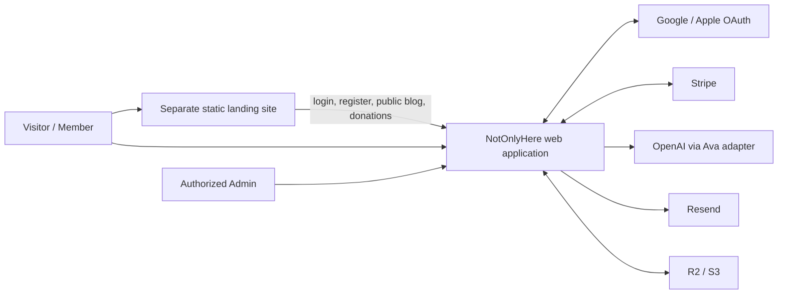
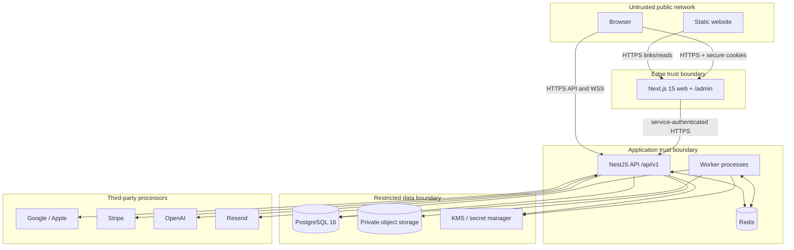
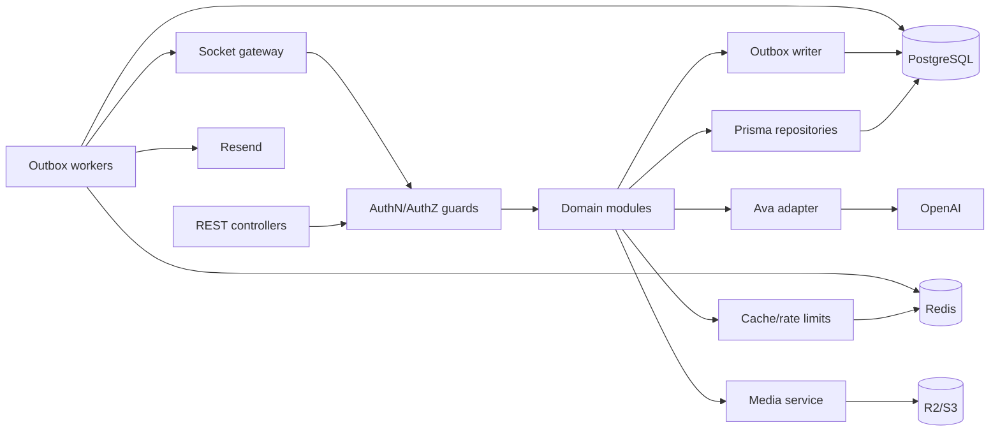
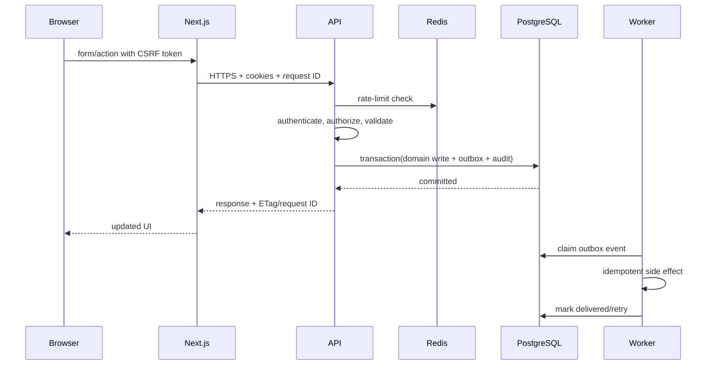

# NotOnlyHere Technical Design

**Status:** Proposed implementation baseline
**Mode:** Technical Specification — decisions first
**Scope:** Greenfield authenticated web application and web admin panel
**Related documents:** [Product PRD](./01-product-prd.md) · [UX specification](./02-ux-spec.md) · [Implementation plan](./05-implementation-plan.md) · [Testing plan](./06-testing-plan.md) · [Backend schema](./04-backend-schema.md)

> **Target** describes the intended production architecture. **Transition** describes temporary migration, rollout, or compatibility behavior. If another document conflicts with this specification, the retained/excluded feature list and security constraints in the product PRD take precedence; schema details are canonical in `04-backend-schema.md`.

## 1. Decisions at a glance

| Area | Decision |
|---|---|
| Product boundary | **Target:** authenticated web application only. The existing static landing website remains separately deployed and links to `/login`, `/register`, public blog reads, and donations. There is no native app. |
| Repository | **Target:** TypeScript monorepo: `apps/web`, `apps/api`, `packages/ui`, `packages/contracts`, `packages/config`. |
| Web | Next.js 15, React 19, TypeScript, Tailwind CSS. User app and `/admin` share one deployment; route groups, server-side guards, and RBAC isolate admin UI. |
| API | NestJS under `/api/v1`; REST for commands/queries and Socket.IO for real-time 1:1 text messaging. |
| Data | PostgreSQL 16 with Prisma. PostgreSQL is authoritative. Redis is disposable cache, rate-limit store, pub/sub, and Socket.IO adapter. |
| Files | Private S3-compatible R2/S3 objects; direct presigned uploads followed by server verification. |
| Auth | HttpOnly `Secure` SameSite cookies; short-lived access session plus rotating refresh-token family; hashed refresh tokens; CSRF defense; verified email; Google and Apple OAuth; 16+ attestation. No 2FA. |
| Payments | Stripe Checkout/webhooks for one-time resource purchases and one-time/monthly donations. Monthly donations are not paid community plans and grant no core-community entitlement. |
| AI | Provider-neutral Ava adapter backed initially by OpenAI. No provider training, minimized context, explicit consent for preference-based personalization, no crisis detection. |
| Search | PostgreSQL full-text search and trigram indexes initially; no external search service. |
| Async | Transactional outbox plus idempotent workers for email, reminders, analytics aggregation, AI work, and payment side effects. |
| Hosting | Vercel for Next.js; managed Node runtime for API/workers; managed PostgreSQL 16, Redis, and object storage. |
| Monitoring | Structured logs, OpenTelemetry-compatible traces, platform-native metrics, health checks, and first-party product analytics. No Sentry or PostHog. |
| Compliance posture | GDPR-capable export/deletion and retention schedule. Do not claim HIPAA. Static crisis resources and an AI disclaimer only. |

### 1.1 Why admin remains in `apps/web`

**Target:** Keep `/admin` in the same Next.js application. Admin uses the same design system, authentication cookies, API contracts, and release train. Isolation is enforced at three layers: Next.js route middleware/layout guards for UX, API authorization guards for security, and database-backed permissions for policy. A separate frontend would add operational and contract overhead without creating a meaningful security boundary because the API remains authoritative.

**Revisit only if:** independent compliance ownership, a separate admin identity provider, materially different release cadence, or network-level isolation becomes required.

## 2. Scope and non-goals

### 2.1 Retained capability map

- Authentication: email registration/login, verification, password reset, Google/Apple OAuth, sessions, account deletion; admin impersonation is P2.
- Profiles: core profile fields only; no profile privacy/preferences/badges.
- Community: feed, posts, media, comments, reactions; no content warnings, mentions, hashtags, pinning, or user reports.
- Anonymous sharing: anonymous posts/comments with non-stable display aliases; no consistent pseudonym or AI toxicity gate.
- Circles: Member and Circle Admin roles, invites, search, member list, admin removal, and member mute; no circle moderator role.
- Messaging: 1:1 text, reactions, history/search, Socket.IO; no receipts, typing indicators, files, reports, groups, or voice.
- Ava: private chat, conversation starters, opt-in circle recommendations, history, 50-request rate limit, and consented preference personalization. A separate AI moderation-assist process may flag community posts/comments only; Ava content is never a flag input/target. No crisis detection, summarization, journal prompts, or admin AI configuration.
- Notifications: in-app and event-triggered email, plus admin broadcasts; no digest, push, mute, or preferences.
- Blog: list/post/categories/tags/related/RSS and admin CRUD/scheduling; no product SEO management or author-profile links.
- Wellness: mood plus optional note and 7/30-day trends; no journaling.
- Events: standalone staff-managed creation, RSVP, Month/List calendar views, email reminders; no calendar-file export, virtual links, recurrence, or circle linkage.
- Admin: dashboard, users, circles, blogs, donations, audit, RBAC, analytics, and limited AI safety alerts; no user-report queue, AI config, feature flags, circle-health/moderation analytics.
- Resources: searchable articles/videos/worksheets, free/member/one-time-paid access, basic progress; no course builder, quizzes, PDF downloads, or certificates.
- Donations: Stripe one-time and monthly donations; no recurring paid community plan and no paywall on core community.

### 2.2 Safety boundary

NotOnlyHere is not a medical device or emergency service. Ava displays a persistent AI/non-therapy disclaimer and links to static crisis resources. The system performs no automated crisis detection, emergency escalation, or clinical diagnosis. Moderation-assist flags identify policy-review candidates for authorized admins; they must not be described as crisis alerts or clinical conclusions.

## 3. Architecture

### 3.1 Context diagram



### 3.2 Container diagram and trust boundaries



Every crossing is TLS. Database/object/KMS access is private-network or provider allow-listed where available. Browser input, OAuth assertions, webhooks, uploaded bytes, AI output, and static-site query parameters are untrusted until validated.

### 3.3 API component diagram



## 4. Repository and module ownership

```text
apps/
  web/                 Next.js user app, public app reads, /admin
  api/                 NestJS HTTP API, Socket.IO gateway, worker entrypoint
packages/
  ui/                  accessible shared UI primitives
  contracts/           request/response/event schemas, problem types, generated API client
  config/              TypeScript, lint, Tailwind, environment schema
```

| API module | Owns | May depend on |
|---|---|---|
| Identity | users, credentials, identities, sessions, tokens | Audit, Notifications |
| Profiles | profiles, connections, blocks | Identity |
| Community | posts, comments, media, link previews, reactions, feed | Profiles, Circles, Files, Notifications |
| Anonymous | aliases and anonymous authorship projections | Community, Profiles |
| Circles | circles, membership, invites, mutes | Profiles, Notifications |
| Messaging | conversations, messages, reactions, search, sockets | Profiles, Blocks, Notifications |
| Ava | consent, preferences, AI conversations/messages | Profiles, Circles, Audit |
| Moderation assist | advisory flags on community posts/comments | Community, Admin, Audit |
| Notifications | in-app notifications, email deliveries, broadcasts | Identity, Email adapter |
| Content | blogs, taxonomy, RSS, scheduling | Files, Admin |
| Wellness | check-ins and trends | Identity |
| Events | standalone events, RSVP, Month/List queries, reminders | Profiles, Notifications |
| Resources | catalog, entitlements, progress, purchases | Files, Payments |
| Payments | donations, purchases, Stripe events/webhooks | Identity, Audit |
| Admin | RBAC, dashboard queries, impersonation, audit | all modules through public services |
| Analytics | first-party events and aggregates | Identity (pseudonymous identifiers only) |
| Platform | outbox, idempotency, health, config, crypto | infrastructure adapters |

**Rule:** modules do not read another module's tables directly in application code. They call exported domain services or consume events. Reporting read models may join across tables in reviewed, read-only repository queries.

## 5. Request, event, and real-time flows

### 5.1 Mutating HTTP request



### 5.2 WebSocket messaging

```mermaid
sequenceDiagram
  participant C as Client
  participant G as Socket.IO gateway
  participant R as Redis adapter
  participant D as PostgreSQL
  participant O as Outbox worker
  participant P as Peer client

  C->>G: connect(auth cookie + CSRF-bound origin)
  G->>D: validate session and user
  C->>G: message.send(clientMessageId, conversationId, text)
  G->>D: authorize participant; insert message + outbox
  D-->>G: canonical message
  G-->>C: ack(canonical message)
  O->>R: publish message.created
  R->>P: message.created
  Note over G,P: At-least-once delivery; clients deduplicate by eventId/messageId
```

REST `POST /messages` remains a retry-safe fallback. A socket is transport, never authorization: every command rechecks membership/block state.

### 5.3 Stripe webhook flow

1. Receive raw body; verify Stripe signature before JSON parsing.
2. Insert `stripe_events` by unique provider event ID and return success for prior processed events.
3. In one transaction, update donation/purchase state, create entitlement if applicable, write audit and outbox records, and mark event processed.
4. Unknown object references are quarantined for operator review, not silently accepted.
5. Webhook order is not assumed; state transitions compare provider timestamps/status precedence and may retrieve current Stripe state.

## 6. Identity, sessions, and authorization

### 6.1 Authentication design

- Passwords use Argon2id with parameters calibrated in production; only hashes are stored.
- Access cookie lifetime: **Target 15 minutes**. It contains an opaque session/access identifier or narrowly scoped signed token; authorization state is resolved server-side for sensitive actions.
- Refresh cookie lifetime: **Target 30 days inactivity, 90 days absolute**. Every refresh rotates the token in its family. Tokens are generated from CSPRNG bytes and only a keyed hash is stored.
- Refresh reuse revokes the entire family and records a security audit event. Password reset, suspension, ban, and account deletion revoke all sessions.
- Cookies: `Secure`, `HttpOnly`, narrow `Path`, no broad parent-domain cookie. SameSite=Lax by default. OAuth callback uses state/nonce/PKCE and a short-lived signed transaction cookie.
- CSRF: same-origin enforcement plus synchronizer/double-submit token on state-changing cookie-authenticated requests; reject missing/mismatched `Origin`/`Sec-Fetch-Site`. Webhooks use signatures, not CSRF.
- Registration requires email verification and explicit 16+ attestation before community access. Re-attestation is not inferred from OAuth birthdate.
- Email verification/reset tokens are random, single-use, hashed at rest, purpose-bound, and expiring. Login responses do not reveal whether an account exists.
- Google and Apple identities bind only after verified provider claims and explicit authenticated linking; never merge solely by unverified email.
- No 2FA in scope.

### 6.2 Role and authorization matrix

| Action | Public | Verified member | Circle Admin | Platform Admin | Super Admin |
|---|:---:|:---:|:---:|:---:|:---:|
| Read published blog/RSS | ✓ | ✓ | ✓ | ✓ | ✓ |
| Register/login/donate | ✓ | ✓ | ✓ | ✓ | ✓ |
| Read/write community content | — | ✓ | ✓ | ✓ | ✓ |
| Direct message | — | ✓ | ✓ | ✓ | ✓ |
| Manage own profile/data/sessions | — | ✓ | ✓ | ✓ | ✓ |
| Join/leave circle | — | ✓ | ✓ | ✓ | ✓ |
| Invite/list/remove/mute in owned circle | — | — | ✓ | policy-dependent | policy-dependent |
| View admin dashboard/analytics | — | — | — | permission | ✓ |
| Manage users/circles/blog/donations/resources | — | — | own circle only | permission | ✓ |
| Review limited AI mod-assist flags | — | — | — | permission | ✓ |
| Reveal anonymous author identity with reason | — | — | — | explicit sensitive permission | explicit sensitive permission |
| Assign one of the four fixed platform roles | — | — | — | — | ✓ |
| Impersonate (P2) | — | — | — | explicit permission | explicit permission |

RBAC uses four fixed global roles—Super Admin, Moderator, Content Editor, Analyst—with immutable permission bundles in the initial release. Only a Super Admin can assign or remove these roles from users. Object-level policy still applies. Platform roles never disclose encrypted Ava/wellness content. Impersonation, when delivered, requires reason, short expiry, prominent banner, no payment/credential/security-setting actions, and immutable actor/subject audit fields.

## 7. API standards

### 7.1 Conventions

- Base path `/api/v1`; HTTPS only; JSON UTF-8. Files use direct object-storage upload.
- Contract schemas live in `packages/contracts` and validate both server inputs and generated client outputs.
- IDs are UUIDv7 exposed as opaque strings. Timestamps are UTC RFC 3339 with microseconds where retained.
- Collection pagination uses opaque cursor plus `limit` (default 20, max 100). Response: `{data, page:{nextCursor, hasMore}}`. Offset pagination is limited to bounded admin reports.
- Filters are allow-listed; sort uses documented stable keys with ID as tie-breaker.
- `Idempotency-Key` is required for payment session creation, donations, resource purchases, and admin broadcasts; supported for retryable creates. Keys are scoped to actor+route and request hash for 24 hours.
- Optimistic concurrency uses strong `ETag`/`If-Match` or an explicit `version`. Missing precondition on sensitive edits returns 428; stale writes return 412.
- Request IDs are accepted/generated and returned in `X-Request-Id`.
- Dates, enums, limits, URL schemes, and text normalization are validated at the edge. Unknown properties are rejected for commands.
- Responses do not serialize database models directly. DTOs enforce field-level disclosure.

### 7.2 Endpoint catalog

Legend: **P** public, **M** verified member, **CA** circle admin for object, **A(permission)** platform admin permission. All list endpoints use cursor pagination unless noted.

#### Authentication and account

| Method | Route | Auth | Notes |
|---|---|---|---|
| POST | `/auth/register` | P | Email/password, age attestation; rate-limited |
| POST | `/auth/login` | P | Sets cookies; generic failure |
| POST | `/auth/refresh` | refresh cookie | Rotates family |
| POST | `/auth/logout` | M/session | Revokes current session |
| POST | `/auth/logout-all` | M | Revokes all sessions |
| POST | `/auth/email/verify` | P | Single-use token |
| POST | `/auth/email/resend` | P | Enumeration-safe |
| POST | `/auth/password/forgot` | P | Enumeration-safe |
| POST | `/auth/password/reset` | P | Revokes all sessions |
| GET | `/auth/oauth/:provider/start` | P | Google/Apple, state+PKCE |
| GET | `/auth/oauth/:provider/callback` | P | Validates transaction; redirects allow-listed |
| GET | `/account` | M | Account and consent summary |
| PATCH | `/account` | M | Versioned limited account fields |
| GET/DELETE | `/account/sessions[/:id]` | M | List/revoke sessions |
| POST | `/account/export` | M | Idempotent account-wide GDPR export; not a wellness-module export feature |
| DELETE | `/account` | M | Re-auth, grace period, async erasure |

#### Profiles, connections, blocks

| Method | Route | Auth | Notes |
|---|---|---|---|
| GET/PATCH | `/profiles/me` | M | Core profile; no privacy/preferences/badges |
| GET | `/profiles/:username` | M | Safe public-to-members fields |
| GET | `/connections` | M | Filter status |
| POST | `/connections/requests` | M | Idempotent pair invariant |
| POST | `/connections/:id/accept` | M | Recipient only |
| DELETE | `/connections/:id` | M | Remove/reject |
| GET/POST | `/blocks` | M | List/create block |
| DELETE | `/blocks/:userId` | M | Remove block |

#### Feed, posts, comments, media, reactions

| Method | Route | Auth | Notes |
|---|---|---|---|
| GET | `/feed` | M | Cursor; Relevant/Chronological mode; visibility/circle/author/media/date filters |
| POST | `/posts` | M | Text/up to four images/link preview/circle; anonymous flag; public/members/connections/only-me visibility |
| GET/PATCH/DELETE | `/posts/:id` | M/owner | Visibility policy; versioned update |
| GET | `/posts/:id/comments` | M | Cursor |
| POST | `/posts/:id/comments` | M | Optional parent; anonymous flag |
| PATCH/DELETE | `/comments/:id` | owner | Versioned |
| PUT/DELETE | `/posts/:id/reactions/:kind` | M | Idempotent |
| PUT/DELETE | `/comments/:id/reactions/:kind` | M | Idempotent |
| POST | `/media/uploads` | M | Presign intent; idempotent |
| POST | `/media/:id/complete` | owner | Verify object bytes |
| DELETE | `/media/:id` | owner | Soft metadata delete/object cleanup job |
| POST | `/link-previews` | M | SSRF-safe fetch for an eligible HTTPS URL |
| POST | `/admin/anonymous-authors/:type/:id/reveal` | A(`anonymous_identity.reveal`) | Reason required; returns minimum identity and writes audit |

Post/comment edits are accepted only during the canonical 15-minute edit window. Anonymous post/comment creation shares a 10-per-day account quota under the day-window decision in the PRD. There are intentionally no report, mention, hashtag, content-warning, pin, or moderation-queue routes.

`PUBLIC` post visibility means visible across the authenticated application subject to blocks and context; it does not publish a feed item to the separate static website or make it an unauthenticated endpoint. Any later public-web feed rendering requires a new product/privacy decision.

#### Circles

| Method | Route | Auth | Notes |
|---|---|---|---|
| GET | `/circles` | M | Search + cursor |
| POST | `/circles` | M/policy | Public/private/hidden plus open/approval/private join policy; creates owner as Circle Admin; may be pending global approval |
| GET/PATCH/DELETE | `/circles/:id` | M/CA | Versioned; delete archives first |
| POST/DELETE | `/circles/:id/membership` | M | Join/request/leave subject to visibility and join policy |
| GET | `/circles/:id/members` | member | Cursor |
| GET | `/circles/:id/membership-requests` | CA | Pending requests |
| POST | `/circles/:id/membership-requests/:userId/approve` | CA | Idempotent current-state resolution |
| POST | `/circles/:id/membership-requests/:userId/decline` | CA | Idempotent current-state resolution |
| DELETE | `/circles/:id/members/:userId` | CA | Cannot remove sole admin |
| POST/GET | `/circles/:id/invites` | CA | Create/list authorized invites |
| POST | `/circle-invites/:token/accept` | M | Single-use/expiry |
| POST | `/circle-invites/:token/decline` | M | Single-use/expiry |
| DELETE | `/circle-invites/:id` | issuer/CA | Revoke |
| PUT/DELETE | `/circles/:id/mutes/:userId` | CA | Circle-scoped mute |
| POST | `/circles/:id/posts/:postId/remove` | CA | Reason required; circle presentation removal + audit |

Only `MEMBER` and `ADMIN` circle roles exist.

#### Messaging

| Method | Route | Auth | Notes |
|---|---|---|---|
| GET/POST | `/conversations` | M | List; create unique 1:1 by mutually connected user ID |
| GET | `/conversations/:id` | participant | Metadata |
| GET | `/conversations/:id/messages` | participant | Cursor history |
| POST | `/conversations/:id/messages` | participant | Text only; `clientMessageId` dedup |
| PUT/DELETE | `/messages/:id/reactions/:emoji` | participant | Approved emoji; idempotent |
| GET | `/messages/search` | M | Own conversations; FTS query |

No receipts, typing, attachments, reporting, groups, or voice APIs.

#### Ava AI

| Method | Route | Auth | Notes |
|---|---|---|---|
| GET/PUT | `/ai/consent` | M | Separate AI use and personalization consent |
| GET/PUT | `/ai/preferences` | M+consent | Explicit preferences only |
| GET/POST | `/ai/conversations` | M+AI consent | List/create |
| GET/DELETE | `/ai/conversations/:id` | owner | History/delete |
| GET | `/ai/conversations/:id/messages` | owner | Cursor |
| POST | `/ai/conversations/:id/messages` | owner | 50 per approved day window; sync/stream contract |
| GET | `/ai/conversation-starters` | M | Curated/config-in-code starters |
| GET | `/ai/circle-recommendations` | M+opt-in | Explainable; no silent enrollment |
| GET/PATCH | `/admin/ai/flags[/:id]` | A(`ai_flags.review`) | Limited policy flags only |

#### Notifications

| Method | Route | Auth | Notes |
|---|---|---|---|
| GET | `/notifications` | M | Cursor |
| PATCH | `/notifications/:id/read` | owner | Idempotent |
| POST | `/notifications/read-all` | M | Idempotent |
| POST | `/admin/broadcasts` | A(`broadcast.create`) | Idempotency required; auditable |
| GET | `/admin/broadcasts/:id` | A(`broadcast.read`) | Delivery summary |

No digest, push, mute, or preference endpoints.

#### Blogs and public integration

| Method | Route | Auth | Notes |
|---|---|---|---|
| GET | `/blogs` | P | Published only; category/tag/search/cursor |
| GET | `/blogs/:slug` | P | Published only |
| GET | `/blogs/:slug/related` | P | Deterministic taxonomy relation |
| GET | `/blog-categories` | P | Reference list |
| GET | `/blog-tags` | P | Reference list |
| GET | `/blogs/rss.xml` | P | XML; cacheable |
| GET/POST | `/admin/blogs` | A(`blog.read/write`) | Includes drafts |
| GET/PATCH/DELETE | `/admin/blogs/:id` | A(`blog.read/write`) | Versioned, archive semantics |
| POST | `/admin/blogs/:id/publish` | A(`blog.publish`) | Immediate |
| POST | `/admin/blogs/:id/schedule` | A(`blog.publish`) | UTC timestamp |
| POST | `/admin/blogs/:id/unpublish` | A(`blog.publish`) | Audited |
| CRUD | `/admin/blog-categories`, `/admin/blog-tags` | A(`blog.taxonomy`) | Slug uniqueness |

The static site may consume these public read endpoints server-side. CORS is allow-listed to known static-site origins; no shared cookies are needed.

#### Wellness

| Method | Route | Auth | Notes |
|---|---|---|---|
| GET/POST | `/wellness/checkins` | M | Date cursor; one per configured period |
| GET/PATCH/DELETE | `/wellness/checkins/:id` | owner | Mood + optional note |
| GET | `/wellness/trends` | owner | `window=7d|30d`; aggregate only |

#### Standalone events

| Method | Route | Auth | Notes |
|---|---|---|---|
| GET | `/events` | M | Search/list standalone events |
| POST | `/events` | A(`event.write`) | Conservative release default: staff/Super Admin only |
| GET | `/events/:id` | M | Visibility-safe detail |
| PATCH/DELETE | `/events/:id` | A(`event.write`) | Versioned; ordinary members cannot mutate |
| PUT/DELETE | `/events/:id/rsvp` | M | Idempotent |
| GET | `/events/:id/attendees` | M | Visibility-safe cursor |

Eligible `GOING`/`MAYBE` RSVP members receive system-managed, idempotent 24-hour and 1-hour email reminders. There is no user reminder preference endpoint. No recurrence, virtual meeting URL, or circle relation.

#### Resources, progress, and purchases

| Method | Route | Auth | Notes |
|---|---|---|---|
| GET | `/resources` | M | Search/type/access filters; conservative app-only default |
| GET | `/resources/:slug` | M | Entitlement-filtered metadata/body/media |
| PUT | `/resources/:id/progress` | M | Basic percent/completed state |
| POST | `/resources/:id/purchase-session` | M | Idempotency required; paid only |
| GET | `/purchases/:id` | owner | Status |
| CRUD | `/admin/resources[/:id]` | A(`resource.write`) | Versioned |

Worksheets are rendered in-app; no downloadable PDF endpoint. `MEMBER` access requires verified membership, not payment.

`PUBLIC_FREE` is representable for a future approved static-site handoff, but no unauthenticated resource endpoint ships under the OQ-06 conservative default. Enabling public reads requires an explicit contract/route review.

#### Donations and payments

| Method | Route | Auth | Notes |
|---|---|---|---|
| POST | `/donations/checkout-session` | P/M | One-time or monthly; idempotent |
| GET | `/donations/:publicId/status` | donor via signed token/M | No sensitive billing data |
| POST | `/payments/stripe/webhook` | Stripe signature | Raw body; event idempotency |
| GET | `/admin/donations` | A(`donation.read`) | Filter/export |
| GET | `/admin/donations/:id` | A(`donation.read`) | Redacted payer data |

Monthly donations create Stripe subscriptions solely for donations; they confer no role or product entitlement.

#### Admin, audit, analytics

| Method | Route | Auth | Notes |
|---|---|---|---|
| GET | `/admin/dashboard` | A(`dashboard.read`) | Bounded aggregate cards |
| GET | `/admin/users[/:id]` | A(`user.read`) | Redacted user list/detail; no password access |
| POST | `/admin/users/:id/suspend` | A(`user.enforce`) | Reason, optional expiry, revoke sessions; policy-limited Moderator or Super Admin |
| POST | `/admin/users/:id/ban` | Super Admin | Reason, indefinite until explicit restore, revoke sessions |
| POST | `/admin/users/:id/restore` | A(`user.enforce`) | Resolve active enforcement; audited |
| GET/PATCH | `/admin/circles[/:id]` | A(`circle.read/write`) | Operational management |
| GET | `/admin/audit-logs` | A(`audit.read`) | Cursor; append-only |
| GET | `/admin/roles` | Super Admin | Read the four fixed global roles and permission bundles |
| PUT/DELETE | `/admin/users/:id/roles/:roleId` | Super Admin | Assign/remove fixed role only; audited; protect last Super Admin |
| POST | `/admin/impersonations` | A(`impersonate`) | P2, reason + expiry |
| DELETE | `/admin/impersonations/current` | impersonating admin | Stop |
| POST | `/analytics/events` | P/M | Allow-listed first-party events |
| GET | `/admin/analytics/users` | A(`analytics.read`) | Aggregates |
| GET | `/admin/analytics/engagement` | A(`analytics.read`) | Aggregates |
| GET | `/admin/analytics/funnel` | A(`analytics.read`) | Named funnel |
| POST | `/admin/analytics/exports` | A(`analytics.export`) | Idempotent async export |

No feature-flag, AI configuration, user-report queue, circle-health, or moderation analytics endpoints.

## 8. WebSocket contract

Namespace: `/messages`; Socket.IO over WSS with long-poll fallback allowed only if operationally required. Authenticate during handshake from secure cookies, validate origin, and disconnect promptly on session revocation via pub/sub.

| Direction | Event | Payload core | Semantics |
|---|---|---|---|
| C→S | `conversation.join` | `conversationId` | Authorize participant; ack success/error |
| C→S | `conversation.leave` | `conversationId` | Leave room |
| C→S | `message.send` | `conversationId`, `clientMessageId`, `text` | Persist before ack; text only |
| C→S | `reaction.set` | `messageId`, `emoji` | Approved emoji; idempotent upsert |
| C→S | `reaction.remove` | `messageId`, `emoji` | Idempotent delete |
| S→C | `message.created` | canonical message, `eventId` | At least once |
| S→C | `reaction.changed` | aggregate/change, `eventId` | At least once |
| S→C | `session.revoked` | reason | Client must clear state/re-auth |
| S→C | `error` | problem subset | Command-scoped, no sensitive detail |

Delivery is **at least once**, not exactly once. `clientMessageId` is unique per sender and makes sends retry-safe. Server events contain stable event IDs; clients deduplicate and reconcile from REST after reconnect using the latest message cursor. Offline push and guaranteed email for each message are not promised. There are no receipt or typing events.

## 9. Background jobs and outbox

The domain transaction inserts an `outbox_events` row alongside state changes. Workers claim with `FOR UPDATE SKIP LOCKED`, use bounded batches, renew leases, and mark completion. Handlers are idempotent. Exponential backoff with jitter ends in a dead-letter state and operator alert; replay is permissioned and audited.

| Job | Trigger | SLA/behavior |
|---|---|---|
| Transactional email | outbox event | Verification/reset promptly; dedup by delivery key |
| Event notification email | outbox event | Near-real-time; suppress if account is suspended, banned, or deletion-pending |
| Admin broadcast fan-out | explicit command | Chunk recipients; resumable |
| Event reminder | scheduled scan | Enqueue due reminders in UTC; unique reminder occurrence |
| Suspension expiry | scheduled scan | Resolve due suspensions atomically, restore only eligible accounts, audit, and notify through outbox |
| Blog publishing | scheduled scan | Atomic `SCHEDULED→PUBLISHED`; invalidate cache |
| Payment processing | Stripe event | Idempotent state/entitlement update |
| Object cleanup | media/account delete | Delete object after reference and retention checks |
| GDPR export | account command | Encrypted account-wide archive, including legally exportable wellness data; signed short-lived link; expiry cleanup. This is not a wellness CSV/PDF feature. |
| GDPR deletion | grace expiry | Ordered erase/anonymize with legal/payment exceptions |
| Analytics aggregation | periodic | Daily pseudonymous aggregates |
| AI flag evaluation | community post/comment publication | Limited community-policy categories; no Ava transcript scanning and no crisis classifier |
| Retention purge | scheduled | Policy-driven batches with audit counts |

Redis queues may signal work, but PostgreSQL outbox rows are the durable source. A lost Redis event must be recoverable by polling.

## 10. Ava AI architecture and safety

### 10.1 Adapter

`AvaProvider` exposes `generateReply`, `streamReply` (if enabled), model metadata, and deletion/config controls. The domain service owns consent, prompt assembly, rate limits, redaction, persistence, and flags; provider-specific SDK types do not escape the adapter.

### 10.2 Privacy and minimization

- Require explicit AI-use consent before first message. Store consent text version and timestamp.
- Preference personalization has separate explicit consent and a visible preference editor/delete action. Revocation excludes preferences from future prompts immediately.
- Send only the current conversation's bounded recent context and explicitly consented preferences. Do not send wellness notes, DMs, feed history, email, legal name, or payment data.
- Use a provider/API configuration contract that disallows provider training on submitted data. Record provider/model/prompt-template versions, not hidden chain-of-thought.
- Encrypt AI message content and preference values at field level where practical using envelope encryption and managed KMS keys; search is not offered over encrypted AI content.
- Apply documented provider retention controls where available. Deletion removes local content and submits provider deletion requests where provider identifiers and capability permit.

### 10.3 Prompt injection and output handling

- Treat all user and retrieved text as data, delimit it, cap length, normalize Unicode, and instruct the model not to follow embedded instructions.
- No arbitrary tools, URL fetching, code execution, database access, or cross-user retrieval is available to Ava.
- Circle recommendations use a constrained structured output schema and candidates supplied by the server; IDs are checked against visible circles.
- Validate structured output; render as escaped text/approved Markdown with unsafe HTML and links removed.
- Never expose system prompts, secrets, internal policy text, or other users' content.
- Provider timeout/circuit breaker returns a neutral retryable error and static support resources, not fabricated completion.

### 10.4 Mod-assist semantics

Mod-assist may attach a limited flag only to community posts or comments for approved community-policy categories such as harassment, threats toward others, or sexual exploitation indicators. Ava conversations and preferences remain private and are never moderation-assist inputs or flag targets. Flags are advisory, access-restricted, confidence-qualified, and require human review. They do **not** automatically remove content, suspend users, contact authorities, infer diagnosis, or detect crisis/self-harm. The admin screen must use “AI moderation-assist flag,” never “safety/crisis detected.”

The Ava message limit is 50 accepted user messages per UTC calendar day under the conservative PRD default, enforced atomically in Redis with a database fallback/audit counter for abuse investigation. If OQ-04 changes this before API freeze, contracts, schema, tests, and reset copy must change together. Responses show the UTC reset time in the member's locale.

## 11. Media security flow

1. Client requests an upload intent with declared filename, media purpose, size, and MIME.
2. API authorizes purpose, creates `media_assets` in `PENDING`, generates a random object key, and returns a short-lived single-object presigned upload with strict size/content-type constraints.
3. Browser uploads directly to private storage.
4. Client calls completion. API/worker reads object metadata and leading bytes, verifies size, checksum, actual MIME signature, allowed dimensions, and decodability; filename is never trusted.
5. Valid object becomes `READY`; invalid object is quarantined/deleted and metadata becomes `REJECTED`.
6. Reads use short-lived signed URLs or an authenticated proxy after object-level authorization. URLs are not permanent capabilities.
7. Orphaned pending objects are purged. Public blog assets may be copied to a separate public/cacheable prefix only after approval and sanitization.

Initial allow-list: JPEG, PNG, WebP for community/profile images; admin blog/resource video may be an approved external HTTPS embed or separately scanned supported format. SVG, HTML, executables, and PDFs from users are rejected. Exact limits belong in versioned config and tests in `06-testing-plan.md`.

## 12. Search

**Target initial:** PostgreSQL FTS:

- weighted `tsvector` generated/stored columns for blogs, resources, circles, posts, and messages;
- language configuration default `english` with `simple` fallback;
- GIN indexes for documents and `pg_trgm` indexes for usernames/titles/slugs;
- authorization predicates applied in the same SQL query before ranking/limit;
- message search restricted to conversations containing the requester;
- encrypted wellness/Ava content excluded;
- ranking plus stable `(rank, created_at, id)` cursor.

**Transition:** WordPress/BuddyBoss imports build vectors after bulk load. Reindex concurrently before cutover. Adopt an external search service only after measured latency/index-size thresholds and a privacy review.

## 13. Caching and rate limits

### 13.1 Cache policy

| Data | Store/TTL | Invalidation |
|---|---|---|
| Published blog/resource metadata | CDN/Redis, 5–15 min | publish/update event + TTL |
| Circle summaries | Redis, ≤2 min | circle/member aggregate event |
| Permission map | Redis, ≤1 min | role assignment event; DB check for high-risk action |
| Feed pages | Usually uncached per user | query/index optimization first |
| Sessions | PostgreSQL authoritative; Redis hot revocation hint | session mutation |
| Private AI/wellness/messages | No shared cache | client memory only as needed |

Cache keys include schema/version and authorization dimensions. Redis loss degrades performance, not correctness. Never cache responses containing `Set-Cookie` at shared edges.

### 13.2 Rate-limit baseline

| Operation | Baseline |
|---|---|
| Login/register/reset/resend | 5–10 per IP/account per 15 min, progressive delay |
| OAuth start/callback | 20 per IP per 15 min |
| Posts/comments/reactions | separate user burst and sustained limits |
| DMs | 30/min and 300/day per user initially |
| Ava accepted messages | exactly 50 per approved day window/user plus burst cap |
| Upload intents/completions | 20/hour/user initially |
| Public search/blog | IP burst cap with CDN shielding |
| Stripe webhook | signature required; infrastructure abuse limit must not drop valid retries |
| Admin exports/broadcasts | low concurrent/idempotent limits |

Values except Ava's canonical 50 are tunable operational configuration, not product feature flags. Return `429`, `Retry-After`, and problem details without exposing account existence.

## 14. Validation, errors, concurrency, and idempotency

### 14.1 Validation

- Normalize email per identity policy; preserve display value separately if needed. Usernames/slugs use canonical lowercase uniqueness.
- Trim and Unicode-normalize user text; enforce grapheme-aware lengths. Store sanitized output only where rich text is allowed.
- Blog/resource rich text uses a strict server-side sanitizer and versioned schema.
- Monetary amounts are integer minor units with ISO currency; server chooses allowed resource price/donation constraints.
- URLs are parsed and scheme/host allow-listed. Redirect destinations are server-known relative paths.
- Database checks and unique constraints are the final invariant layer.

### 14.2 Problem details

Errors use `application/problem+json`:

```json
{
  "type": "https://api.notonlyhere.com/problems/validation",
  "title": "Request validation failed",
  "status": 422,
  "code": "VALIDATION_FAILED",
  "detail": "One or more fields are invalid.",
  "instance": "/api/v1/posts",
  "requestId": "019...",
  "errors": [{"field": "body", "code": "too_long"}]
}
```

| Status | Use |
|---|---|
| 400 | malformed syntax/protocol |
| 401 | no/invalid session |
| 403 | authenticated but unauthorized |
| 404 | absent or intentionally concealed object |
| 409 | state conflict/duplicate |
| 412/428 | stale/missing precondition |
| 422 | semantic validation |
| 429 | rate limit |
| 503 | temporary dependency/circuit open |

Production details contain no stack, SQL, secret, provider body, or existence leak.

### 14.3 Concurrency and retry

- Unique constraints settle races for memberships, reactions, aliases, RSVPs, purchases, Stripe events, and client message IDs.
- Version columns protect editable content; state machines use conditional updates.
- Transactions use read committed by default; serializable or advisory locks only for narrow invariants such as sole circle admin transfer.
- Deadlock/serialization errors retry a bounded number of times with jitter.
- Idempotency records persist status, request hash, and response reference. Reusing a key with a different body is `409`.

## 15. Security and privacy controls

- OWASP ASVS-informed threat modeling and secure defaults; dependency/code/secret scanning in CI.
- Least-privilege service identities and separate database roles for migration, runtime, worker, and read-only reporting.
- KMS/secret manager; no secrets in repo, client bundles, logs, or general environment dumps. Key rotation is rehearsed.
- TLS in transit; managed disk/object/database encryption at rest; field-level envelope encryption for AI/wellness sensitive text where practical.
- CSP with nonces, HSTS, frame restrictions, MIME sniff prevention, referrer policy, and restrictive permissions policy.
- Parameterized Prisma queries; raw SQL is reviewed and bind-only.
- Audit security/admin/payment/data-export actions with immutable actor, subject, action, result, request ID, and safe diffs.
- Blocks are enforced in feed visibility, profile access, connection creation, circle interaction where applicable, and DMs.
- Data classification and retention are defined in `04-backend-schema.md`; deletion/export workflows are tested in `06-testing-plan.md`.
- Vendors receive only contractually necessary data and are recorded as processors. No HIPAA representation.

## 16. Deployment topology and environments

| Environment | Purpose | Data policy |
|---|---|---|
| Local | Developer Docker services and provider sandboxes | Synthetic/seed only |
| Preview | Per-PR web/API where feasible | Synthetic; no production secrets |
| Staging | Production-like integration, migration rehearsal | Synthetic/anonymized |
| Production | User traffic | Restricted production data |

**Target topology:** Vercel serves Next.js. A managed Node platform runs independently scalable API and worker processes. Managed PostgreSQL has PITR and encrypted backups; managed Redis has high availability as appropriate; object storage uses versioning/lifecycle controls. API and WebSocket share a stable origin such as `api.notonlyhere.com`; allowed web/static origins are explicit.

Environment variables are schema-validated at boot. Preview OAuth/webhook URLs are allow-listed deliberately. Development must not silently fall back to production providers.

## 17. CI/CD, migrations, backup, DR, rollback

### 17.1 Pipeline gates

1. Install from lockfile; verify generated Prisma client/contracts are current.
2. Format, lint, typecheck, unit tests, contract tests, migration lint.
3. Build web/API/worker; run dependency, secret, and container scans.
4. Integration tests against PostgreSQL 16 and Redis; end-to-end critical flows per `06-testing-plan.md`.
5. Deploy preview/staging; smoke health/auth/payment webhook fixtures.
6. Production approval, migration job, API/worker deploy, web deploy, post-deploy smoke.

### 17.2 Migration policy

Use expand/contract:

- expand with nullable columns/new tables/indexes created without long locks;
- deploy code supporting old and new shape;
- backfill in resumable batches with metrics;
- enforce constraints after validation;
- remove old fields only in a later release.

Prisma migration SQL is reviewed; production migrations run once as a dedicated job, never concurrently from app replicas. Destructive migrations require backup verification and a documented restore/forward-fix path.

### 17.3 Backup and disaster recovery

- PostgreSQL automated encrypted backups plus point-in-time recovery; quarterly restore exercise.
- Object storage versioning/lifecycle and inventory; payment truth can be reconciled from Stripe but is not a substitute for backups.
- Redis is non-authoritative and rebuilt.
- Backup access is separately privileged and audited.
- **Initial targets:** RPO ≤ 15 minutes for PostgreSQL, RTO ≤ 4 hours for a regional service recovery. Confirm cost/provider feasibility before launch.
- DR runbook covers database restore, secret rotation, object reconciliation, webhook replay, DNS/origin changes, and user communication ownership.

### 17.4 Rollback

- Application releases are immutable and previous images/builds remain deployable.
- Roll back web/API independently only while contracts are backward compatible.
- Database schema is generally rolled forward; down migrations are reserved for proven safe additive changes.
- Disable a failing worker by deployment scaling/config, leaving outbox events durable for replay.
- Ava/provider failure opens circuit and returns unavailable state; community remains usable.
- Payment checkout can be operationally disabled without changing existing donation/subscription records.
- Rollback criteria and owner are recorded per release in `05-implementation-plan.md`.

## 18. Observability and operations

- JSON structured logs with timestamp, level, service, environment, request/trace ID, route template, status, latency, actor pseudonymous ID, and safe error code. Never log tokens, cookies, message bodies, AI/wellness text, email bodies, or payment payloads.
- OpenTelemetry-compatible traces across web→API→database/cache/provider/jobs with sensitive attributes excluded.
- Platform-native metrics: request rate/error/latency, WebSocket connections/acks, DB pool/query latency, Redis errors, outbox age/dead letters, job retries, provider latency/failure, email outcomes, Stripe lag, upload rejects, cache hit rate.
- `/health/live` checks process only; `/health/ready` checks required dependencies with strict timeout; `/health/startup` covers migrations/config. Public responses reveal minimal detail.
- Alerts are symptom-based: elevated 5xx/latency, auth failure anomaly, DB saturation, stale outbox, webhook lag, backup/restore failure, dead letters, and provider circuit state.
- Runbooks define triage, containment, replay, and escalation. Audit trails are separate from diagnostic logs.
- Product analytics are first-party allow-listed events in PostgreSQL; no Sentry/PostHog or hidden behavioral replay.

## 19. WordPress/BuddyBoss migration

### 19.1 Principles

**Transition:** migration is an ETL project, not runtime dual-write by default. Inventory source versions/plugins/custom fields and legal basis before mapping. Preserve source IDs in dedicated mapping tables or import metadata, not public IDs.

| Source concept | Target |
|---|---|
| WordPress users | users, profiles, identities/credentials where safely transferable |
| BuddyBoss groups/members | circles, circle_members |
| Activity/posts/comments | posts, comments, reactions when mappings are reliable |
| WordPress media | media_assets + object copies/checksums |
| WordPress blog/taxonomy | blog_posts, categories, tags |
| Messages | migrate only with explicit scope/privacy approval; otherwise omit |

### 19.2 Passwords and identity

Do not weaken the new Argon2id policy. Preferred transition is forced password reset for imported password users. If a reviewed legacy-hash verifier is temporarily used, it runs server-side only, rehashes to Argon2id on first successful login, has a removal deadline, and does not support obsolete insecure hashes without security approval. OAuth identities are relinked through providers.

### 19.3 Execution

1. Inventory/export and deterministic mapping specification.
2. Clean/normalize source data; identify deleted/banned/minor/duplicate accounts.
3. Rehearse into isolated staging; produce row counts, orphan reports, checksums, and sampled content comparisons.
4. Bulk import users/reference data, then circles/content/media, then derived indexes.
5. Notify users of activation/reset and changed privacy terms as legally required.
6. Cutover with a bounded source write freeze or delta export.
7. Validate counts, permissions, anonymity, media, search, and sampled timelines.
8. Keep source read-only for approved rollback window, then securely retire under retention policy.

**Rollback:** before accepting new target writes, restore/reopen source. After target writes begin, avoid reverse synchronization; pause, remediate forward, or execute an approved reconciliation plan. Donation/Stripe records are reconciled independently.

## 20. Architecture decision records

| ADR | Decision | Consequence/status |
|---|---|---|
| ADR-001 | Modular monolith NestJS API plus workers | Fast transactional development; modules can be extracted after measured need. Accepted. |
| ADR-002 | User/admin in one Next.js app | Shared contracts/UI; API remains security boundary. Accepted. |
| ADR-003 | PostgreSQL 16 authoritative, Prisma ORM | Strong relational integrity; reviewed SQL needed for FTS/partial indexes. Accepted. |
| ADR-004 | Redis is disposable coordination/cache | No durable business state solely in Redis. Accepted. |
| ADR-005 | REST + Socket.IO only for 1:1 messages | Simple retries/reconciliation; no generalized event API. Accepted. |
| ADR-006 | Transactional outbox | Atomic domain event publication; worker operational burden. Accepted. |
| ADR-007 | PostgreSQL FTS first | Lower cost/complexity; revisit on measured scale. Accepted. |
| ADR-008 | Opaque cookie sessions with rotating refresh families | Revocation/security over stateless simplicity. Accepted. |
| ADR-009 | Provider-neutral Ava adapter with minimized context | Vendor portability/privacy; fewer personalization signals. Accepted. |
| ADR-010 | Field-level encryption for AI/wellness sensitive text | Reduced breach exposure; no FTS and more key operations. Accepted in principle; benchmark before final column set. |
| ADR-011 | Stripe donations separated from entitlements | Monthly donors receive no core access advantage. Accepted. |
| ADR-012 | No automated crisis detection | Static resources/disclaimer only; avoids unsafe clinical implication. Accepted/canonical. |
| ADR-013 | First-party analytics | Data control; requires event governance and aggregation jobs. Accepted. |

## 21. Risks and mitigations

| Risk | Mitigation / rollback |
|---|---|
| Sensitive peer-support data exposure | Minimize collection, field encryption, strict DTOs/RBAC, audit, retention purge, tested restore/delete. |
| AI output causes harm or overreliance | Clear disclaimer, constrained prompts/output, static crisis resources, no clinical claims/detection, provider circuit breaker. |
| Anonymous identity leaks | Separate author linkage from presentation, centralized projection policy, tests for API/admin/log exports. |
| WebSocket duplicates/gaps | At-least-once semantics, stable IDs, client dedup, REST reconciliation. |
| Stripe event duplication/order | Unique events, state machine, current-state retrieval, idempotent transactions. |
| Admin privilege misuse | Granular RBAC, field permissions, audit, no implicit sensitive-content access, constrained impersonation. |
| FTS degrades at scale | Query metrics, GIN/trigram indexes, archive old content, measured migration trigger. |
| Migration imports invalid permissions/anonymity | Rehearsal reports, deterministic mappings, sampled privacy tests, source freeze/rollback window. |
| Redis/provider outage | PostgreSQL truth, graceful degradation, circuit breakers, durable outbox. |
| Database migration lock/outage | Expand/contract, online indexes, rehearsals, lock timeout, forward fix. |

## 22. Open questions requiring product/operations resolution

1. Exact legal retention periods by data category and jurisdiction; defaults proposed in `04-backend-schema.md` require counsel approval.
2. Whether public resources are served from the app domain or mirrored by the static site; entitlement-bearing content must remain app/API controlled.
3. Whether community images require malware scanning beyond MIME/decode checks and which managed scanner is available.
4. Account/conversation deletion treatment for DM bodies and tombstones, including the counterpart's continuing access.
5. Who may create circles and standalone events at launch: every verified member or an approval-limited subset.
6. Which community-policy categories are permitted for AI moderation-assist, and the human review SLA. Crisis/self-harm detection remains excluded regardless.
7. Whether legacy BuddyBoss direct messages have consent/legal basis for migration; default recommendation is not to migrate.
8. Donation currencies/countries, monthly donation cancellation management, and tax receipt wording.
9. RPO/RTO and regional residency commitments after provider cost review.
10. Final upload size/dimension limits and supported admin video strategy.

These questions should become explicit acceptance criteria or implementation tasks in `01-product-prd.md` and `05-implementation-plan.md`, with verification in `06-testing-plan.md`.
