# NotOnlyHere Backend Schema

**Status:** Proposed canonical PostgreSQL design
**Database:** PostgreSQL 16 · Prisma
**Related documents:** [Product PRD](./01-product-prd.md) · [UX specification](./02-ux-spec.md) · [Technical design](./03-tech-design.md) · [Implementation plan](./05-implementation-plan.md) · [Testing plan](./06-testing-plan.md)

> **Target** is the production schema. **Transition** identifies import/backfill compatibility. PostgreSQL constraints are authoritative even when Prisma also validates an invariant. The catalog specifies important columns rather than every operational timestamp; unless stated otherwise, mutable tables include `created_at timestamptz NOT NULL DEFAULT now()` and `updated_at timestamptz NOT NULL DEFAULT now()`.

## 1. Decisions first

1. **Target:** PostgreSQL 16 is the only system of record. Redis contains no irreplaceable business state.
2. All business IDs are UUIDv7 (`uuid`); externally supplied provider IDs remain `text` under unique constraints. Join tables use composite primary keys unless an addressable row is required.
3. Prisma owns models and ordinary migrations. Reviewed SQL migrations own extensions, generated FTS vectors, partial/expression indexes, exclusion constraints, partitioning, and database triggers Prisma cannot represent.
4. Relational columns and typed join tables represent authorization, ownership, lifecycle, taxonomy, and money. JSONB is restricted to bounded snapshots/payloads where fields are not queried for business logic.
5. Soft deletion is used when tombstones, auditability, recovery, or referential continuity matter. GDPR erasure anonymizes or hard-deletes according to legal purpose; soft deletion alone is not erasure.
6. Sensitive Ava and wellness text is envelope-encrypted at the application layer where practical. Ciphertext, key version, and nonce/context metadata are stored; plaintext is never indexed or logged.
7. Anonymous display identity is deliberately non-stable. Author linkage remains restricted for ownership/block enforcement but member responses never expose it.
8. Payment tables retain minimum legally required records; Stripe stores card/bank details. NotOnlyHere stores no PAN/CVC.
9. The transactional outbox is committed with domain writes. Idempotency keys are database-backed.
10. No schema supports struck features: recurring paid plans, journaling, user reports, group/file/voice messaging, push/digests, crisis detection, course/quiz/certificate systems, or feature flags.

## 2. Conventions

### 2.1 Names, keys, and time

- Schema: `public` initially; table/column names `snake_case`; Prisma maps ergonomic model names with `@@map`/`@map`.
- Primary keys: application-generated monotonic UUIDv7 to reduce B-tree churn.
- Time: `timestamptz` in UTC. A user event's local display zone is an IANA `text` value validated in the application.
- Money: `bigint` integer minor units plus `char(3)` ISO-4217 uppercase currency. Amount checks are positive unless zero is explicitly valid.
- User text uses `text` plus database length checks on normalized character count where stable; application also enforces grapheme limits.
- Slugs and usernames are canonical lowercase text with unique indexes on `lower(value)` if stored display casing is retained.
- Mutable aggregate roots include `version integer NOT NULL DEFAULT 1 CHECK (version > 0)` for optimistic concurrency.
- Lifecycle values are enums or constrained text. New enum values are additive; removing/renaming uses transition columns.
- Foreign keys are indexed unless covered by the leading columns of another index.

### 2.2 Extensions

| Extension | Purpose |
|---|---|
| `pgcrypto` | cryptographic helper functions/import utilities; application still generates UUIDv7 and performs envelope encryption |
| `citext` | case-insensitive email/username candidates where appropriate |
| `pg_trgm` | fuzzy/prefix search for usernames, circle/resource/blog titles |

PostgreSQL built-in full-text search uses generated `tsvector` columns and GIN indexes. Extensions must be provisioned by a privileged migration role, not runtime.

### 2.3 Shared deletion semantics

| FK behavior | Use |
|---|---|
| `ON DELETE CASCADE` | dependent row has no meaning alone: reactions, memberships, tags, token rows |
| `ON DELETE RESTRICT` | deletion would violate history/payment/audit integrity |
| `ON DELETE SET NULL` | attribution may disappear while public/operational record remains |
| Application-managed | user erasure, encrypted data purge, media object deletion, aggregate archival |

`users` is rarely physically deleted immediately. `status`, `deleted_at`, and anonymization workflows protect references. Audit/payment rows reference a nullable user and retain a pseudonymous subject reference where legally required.

## 3. Data classification and encryption

| Class | Examples | Controls |
|---|---|---|
| C0 Public | published blog, public resource metadata | Integrity controls, CDN-safe |
| C1 Internal | aggregate analytics, operational statuses, non-sensitive IDs | authenticated service access |
| C2 Personal | email, profile name, IP/user agent, OAuth subject | least privilege, encrypted infrastructure, redacted logs |
| C3 Sensitive community | private messages, blocks, anonymous author link, circle membership | object authorization, restricted admin access, no shared cache |
| C4 Highly sensitive | Ava content/preferences, wellness notes, account export | field encryption where practical, separate permission, access audit, short retention |
| C5 Financial/legal | Stripe customer/event references, donation/purchase records, admin audit | restricted roles, legal retention, immutable history |

### 3.1 Envelope-encrypted column pattern

Encrypted logical values use:

- `<field>_ciphertext bytea NULL`
- `<field>_key_version smallint NULL`
- `<field>_nonce bytea NULL` when the crypto format does not embed it
- optional `<field>_blind_index bytea NULL` only if an approved exact-match need exists

Associated authenticated data binds ciphertext to table, row ID, user ID, and logical column. Data encryption keys are wrapped/derived through managed KMS; key material is not stored in PostgreSQL. **Target encrypted:** `wellness_checkins.note`, `ai_preferences.value`, `ai_messages.content`, and potentially `ai_conversations.title` if user-derived. DMs are C3 but not field-encrypted initially because user search is retained; revisit with threat model and searchable-encryption trade-off.

## 4. Enumerations

Enums shown are canonical starting values; migration names should be prefixed by domain where ambiguity exists.

| Enum | Values |
|---|---|
| `user_status` | `PENDING_VERIFICATION`, `ACTIVE`, `SUSPENDED`, `BANNED`, `DELETION_PENDING`, `ANONYMIZED` |
| `identity_provider` | `GOOGLE`, `APPLE` |
| `token_purpose` | `VERIFY_EMAIL`, `RESET_PASSWORD`, `CHANGE_EMAIL` |
| `connection_status` | `PENDING`, `ACCEPTED`, `REJECTED` |
| `content_status` | `ACTIVE`, `DELETED`, `REMOVED` |
| `post_visibility` | `PUBLIC`, `MEMBERS`, `CONNECTIONS`, `ONLY_ME` |
| `media_status` | `PENDING`, `READY`, `REJECTED`, `DELETED` |
| `media_purpose` | `AVATAR`, `PROFILE_COVER`, `POST_IMAGE`, `BLOG_IMAGE`, `RESOURCE_MEDIA` |
| `reaction_kind` | `SUPPORT`, `HUG`, `INSIGHTFUL` |
| `circle_visibility` | `PUBLIC`, `PRIVATE`, `HIDDEN` |
| `circle_join_policy` | `OPEN`, `APPROVAL`, `PRIVATE` |
| `circle_role` | `MEMBER`, `ADMIN` |
| `membership_status` | `PENDING`, `ACTIVE`, `DECLINED`, `LEFT`, `REMOVED` |
| `message_status` | `ACTIVE`, `DELETED` |
| `ai_role` | `USER`, `ASSISTANT` |
| `ai_flag_status` | `OPEN`, `REVIEWED`, `DISMISSED`, `ACTIONED` |
| `notification_channel` | `IN_APP`, `EMAIL` |
| `notification_status` | `PENDING`, `SENT`, `FAILED`, `CANCELLED` |
| `blog_status` | `DRAFT`, `SCHEDULED`, `PUBLISHED`, `ARCHIVED` |
| `event_status` | `DRAFT`, `PUBLISHED`, `CANCELLED`, `COMPLETED` |
| `rsvp_status` | `GOING`, `MAYBE`, `NOT_GOING` |
| `event_reminder_kind` | `HOURS_24`, `HOUR_1` |
| `resource_kind` | `ARTICLE`, `VIDEO`, `WORKSHEET` |
| `resource_access` | `PUBLIC_FREE`, `MEMBER`, `PAID_ONCE` |
| `purchase_status` | `PENDING`, `PAID`, `FAILED`, `REFUNDED` |
| `donation_frequency` | `ONE_TIME`, `MONTHLY` |
| `donation_status` | `PENDING`, `SUCCEEDED`, `ACTIVE`, `PAST_DUE`, `CANCELLED`, `FAILED`, `REFUNDED` |
| `outbox_status` | `PENDING`, `PROCESSING`, `DELIVERED`, `DEAD` |

Prefer lookup/reference tables instead of enums where administrators may change values (analytics event definitions, permissions). There is no enum value for Circle Moderator.

## 5. Entity relationship overview

The diagram emphasizes ownership and major relationships; detailed joins and constraints follow.

```mermaid
erDiagram
  USERS ||--o| CREDENTIALS : has
  USERS ||--o{ USER_IDENTITIES : links
  USERS ||--o{ SESSION_FAMILIES : owns
  USERS ||--o{ USER_ENFORCEMENTS : subject_to
  SESSION_FAMILIES ||--o{ SESSIONS : rotates
  USERS ||--|| PROFILES : has
  USERS ||--o{ POSTS : authors
  USERS ||--o{ COMMENTS : authors
  POSTS ||--o{ COMMENTS : contains
  POSTS ||--o{ POST_MEDIA : attaches
  MEDIA_ASSETS ||--o{ POST_MEDIA : used_by
  POSTS ||--o{ POST_REACTIONS : receives
  COMMENTS ||--o{ COMMENT_REACTIONS : receives
  CIRCLES ||--o{ CIRCLE_MEMBERS : contains
  USERS ||--o{ CIRCLE_MEMBERS : joins
  CIRCLES ||--o{ POSTS : scopes
  CONVERSATIONS ||--o{ CONVERSATION_PARTICIPANTS : has
  USERS ||--o{ CONVERSATION_PARTICIPANTS : participates
  CONVERSATIONS ||--o{ MESSAGES : contains
  MESSAGES ||--o{ MESSAGE_REACTIONS : receives
  USERS ||--o{ AI_CONVERSATIONS : owns
  AI_CONVERSATIONS ||--o{ AI_MESSAGES : contains
  POSTS ||--o{ AI_MOD_FLAGS : may_flag
  COMMENTS ||--o{ AI_MOD_FLAGS : may_flag
  USERS ||--o{ NOTIFICATIONS : receives
  BLOG_POSTS }o--o{ BLOG_CATEGORIES : classified
  BLOG_POSTS }o--o{ BLOG_TAGS : tagged
  USERS ||--o{ WELLNESS_CHECKINS : records
  USERS ||--o{ EVENTS : creates
  EVENTS ||--o{ EVENT_SCHEDULE_VERSIONS : schedules
  EVENTS ||--o{ EVENT_RSVPS : has
  RESOURCES ||--o{ RESOURCE_PROGRESS : tracks
  RESOURCES ||--o{ RESOURCE_PURCHASES : purchased
  USERS ||--o{ DONATIONS : makes
  ADMIN_ROLES }o--o{ ADMIN_PERMISSIONS : grants
  USERS }o--o{ ADMIN_ROLES : assigned
  USERS ||--o{ AUDIT_LOGS : acts
  USERS ||--o{ ANALYTICS_EVENTS : emits
```

## 6. Identity and account tables

### `users` — account root (C2)

| Column | Type / nullability / default | Notes |
|---|---|---|
| `id` | `uuid PK` | UUIDv7 |
| `email` | `citext NOT NULL` | current normalized email |
| `status` | `user_status NOT NULL DEFAULT 'PENDING_VERIFICATION'` | account state |
| `email_verified_at` | `timestamptz NULL` | required for member access |
| `activated_at` | `timestamptz NULL` | first transition to active; cohort metric anchor |
| `age_attested_at` | `timestamptz NULL` | explicit 16+ attestation |
| `terms_version`, `privacy_version`, `community_guidelines_version` | `text NOT NULL` | accepted document versions |
| `terms_accepted_at`, `privacy_accepted_at`, `community_guidelines_accepted_at` | `timestamptz NOT NULL` | acceptance evidence |
| `locale`, `time_zone` | `text NULL` | validated locale/IANA zone |
| `last_login_at` | `timestamptz NULL` | operational |
| `deletion_requested_at`, `deletion_due_at`, `deleted_at` | `timestamptz NULL` | erasure workflow |
| `anonymized_reference` | `uuid NOT NULL UNIQUE` | stable non-identifying reference for retained records |
| `version` | `integer NOT NULL DEFAULT 1` | optimistic concurrency |

Constraints/indexes: unique `email` only for live/non-anonymized accounts via partial unique index if erased emails must be reusable; status/timestamp consistency checks; indexes `(status, created_at)`, `(deletion_due_at) WHERE status='DELETION_PENDING'`. `SUSPENDED` and `BANNED` require an active enforcement record. Deletion is application-managed and normally ends at `ANONYMIZED`.

### `user_enforcements` — suspension/ban history (C5)

`id uuid PK`; `user_id uuid NOT NULL FK users ON DELETE RESTRICT`; `kind text NOT NULL CHECK (kind IN ('SUSPENSION','BAN'))`; `reason_code text NOT NULL`; `reason_detail text NULL`; `starts_at timestamptz NOT NULL`; `ends_at timestamptz NULL`; `resolved_at timestamptz NULL`; `resolved_by_user_id uuid NULL FK users ON DELETE SET NULL`; `created_by_user_id uuid NULL FK users ON DELETE SET NULL`; `created_at`.

Checks: bans have no automatic `ends_at`; suspension end must follow start; resolution timestamps are consistent. A partial unique index allows at most one unresolved enforcement per user. Indexes `(user_id, created_at DESC)`, `(ends_at) WHERE resolved_at IS NULL`. Creating an enforcement updates `users.status`, revokes all session families, and writes audit plus notification-email outbox records in one transaction; the worker sends email after commit. A scheduled job resolves expired suspensions idempotently. Restore returns the user to `ACTIVE` only when no other blocking state exists.

### `credentials` — password credential (C4)

| Column | Type | Notes |
|---|---|---|
| `user_id` | `uuid PK FK users ON DELETE CASCADE` | max one password credential |
| `password_hash` | `text NOT NULL` | Argon2id encoded hash |
| `password_changed_at` | `timestamptz NOT NULL` | session invalidation boundary |
| `failed_attempts` | `smallint NOT NULL DEFAULT 0` | database fallback, not sole rate limiter |
| `locked_until` | `timestamptz NULL` | temporary lock |
| `legacy_hash` | `text NULL` | **Transition only**, encrypted/restricted if used |
| `legacy_scheme` | `text NULL` | **Transition only** |

Checks: failed attempts nonnegative; legacy fields both null or both present. Legacy columns must be removed after migration deadline.

### `user_identities` — OAuth identities (C2)

| Column | Type | Notes |
|---|---|---|
| `id` | `uuid PK` | |
| `user_id` | `uuid NOT NULL FK users ON DELETE CASCADE` | |
| `provider` | `identity_provider NOT NULL` | Google/Apple |
| `provider_subject` | `text NOT NULL` | stable `sub`; never email as identity key |
| `provider_email` | `citext NULL` | last verified claim, informational |
| `provider_email_verified` | `boolean NOT NULL DEFAULT false` | |
| `linked_at`, `last_used_at` | `timestamptz NOT NULL` | |

Unique `(provider, provider_subject)` and `(user_id, provider)`; index `user_id`. Unlink must preserve at least one login method.

### `session_families` — refresh-token families (C3)

| Column | Type | Notes |
|---|---|---|
| `id` | `uuid PK` | |
| `user_id` | `uuid NOT NULL FK users ON DELETE CASCADE` | |
| `created_ip_hash`, `last_ip_hash` | `bytea NULL` | keyed hash; no raw long-term IP |
| `user_agent_summary` | `text NULL` | bounded/redacted |
| `absolute_expires_at` | `timestamptz NOT NULL` | hard max |
| `last_used_at` | `timestamptz NOT NULL` | inactivity enforcement |
| `revoked_at` | `timestamptz NULL` | |
| `revocation_reason` | `text NULL` | constrained application code |

Indexes `(user_id, revoked_at)`, `(absolute_expires_at)`. Cascades on hard user deletion.

### `sessions` — rotating refresh generations (C4)

| Column | Type | Notes |
|---|---|---|
| `id` | `uuid PK` | access session reference |
| `family_id` | `uuid NOT NULL FK session_families ON DELETE CASCADE` | |
| `generation` | `integer NOT NULL CHECK (generation >= 0)` | |
| `refresh_token_hash` | `bytea NOT NULL UNIQUE` | keyed hash only |
| `issued_at`, `expires_at` | `timestamptz NOT NULL` | |
| `rotated_at`, `revoked_at` | `timestamptz NULL` | |
| `replaced_by_id` | `uuid NULL FK sessions ON DELETE SET NULL` | rotation chain |

Unique `(family_id, generation)`; indexes `(family_id, revoked_at)`, `(expires_at)`. A used/rotated token reuse revokes family transactionally.

### `email_tokens` — verification/reset/change tokens (C4)

`id uuid PK`; `user_id uuid NOT NULL FK users ON DELETE CASCADE`; `purpose token_purpose NOT NULL`; `token_hash bytea NOT NULL UNIQUE`; `target_email citext NULL`; `expires_at timestamptz NOT NULL`; `consumed_at timestamptz NULL`; `attempt_count smallint NOT NULL DEFAULT 0`; timestamps.

Indexes `(user_id, purpose, created_at DESC)`, `(expires_at) WHERE consumed_at IS NULL`. At most one active token per purpose is enforced by transaction/advisory lock because `now()` cannot appear safely in a partial-index predicate. Purge shortly after expiry/consumption.

### `account_exports` — GDPR export jobs (C4)

`id uuid PK`; `user_id uuid NOT NULL FK users ON DELETE CASCADE`; `status text NOT NULL CHECK (...)`; `object_key text NULL UNIQUE`; `requested_at`, `completed_at`, `expires_at`; `error_code text NULL`; `idempotency_key text NULL`; unique `(user_id, idempotency_key)` where key present. Private object is encrypted and deleted on expiry.

This job produces an account-wide statutory/GDPR export and may include the requesting member's wellness records. It does not create a wellness-module CSV/PDF export feature.

## 7. Profiles and social graph

### `profiles` (C2)

`user_id uuid PK FK users ON DELETE CASCADE`; `username citext NOT NULL`; `display_name text NOT NULL`; `bio text NULL`; `avatar_media_id uuid NULL FK media_assets ON DELETE SET NULL`; `cover_media_id uuid NULL FK media_assets ON DELETE SET NULL` (both media FKs added after the media table migration); `version integer NOT NULL DEFAULT 1`; timestamps.

Constraints: unique username; format/length checks; indexes `GIN (username gin_trgm_ops)`, `GIN (display_name gin_trgm_ops)`. No privacy, preference, or badge columns.

### `connections` (C3)

`id uuid PK`; `requester_id`, `addressee_id uuid NOT NULL FK users ON DELETE CASCADE`; `status connection_status NOT NULL`; `responded_at timestamptz NULL`; timestamps.

Checks: users differ. Unique normalized pair via unique expression index on `least(requester_id, addressee_id), greatest(...)`, preventing two directional records. Index `(addressee_id, status, created_at)`, `(requester_id, status)`.

### `user_blocks` (C3)

`blocker_id uuid FK users ON DELETE CASCADE`; `blocked_id uuid FK users ON DELETE CASCADE`; `created_at`; composite PK `(blocker_id, blocked_id)`; check IDs differ; reverse index `(blocked_id, blocker_id)`.

Block checks are mandatory in social/profile/message queries. Erasure cascades these private preferences.

## 8. Media, posts, anonymous authorship, comments, reactions

### `media_assets` (C2/C3 depending purpose)

| Column | Type | Notes |
|---|---|---|
| `id` | `uuid PK` | |
| `owner_user_id` | `uuid NULL FK users ON DELETE SET NULL` | null for retained public admin content |
| `purpose` | `media_purpose NOT NULL` | |
| `status` | `media_status NOT NULL DEFAULT 'PENDING'` | |
| `object_key` | `text NOT NULL UNIQUE` | random, never user filename |
| `original_filename` | `text NULL` | sanitized, C2 |
| `declared_mime`, `detected_mime` | `text NULL` | detected required when ready |
| `byte_size` | `bigint NULL CHECK (byte_size > 0)` | |
| `sha256` | `bytea NULL` | integrity/dedup signal, not global disclosure |
| `width`, `height` | `integer NULL` | image dimensions |
| `verified_at`, `deleted_at` | `timestamptz NULL` | |

Indexes `(owner_user_id, created_at)`, `(status, created_at)`. State consistency checks. Metadata deletion triggers asynchronous object deletion; references generally `SET NULL` or join cascade.

### `post_anonymous_authors` and `comment_anonymous_authors` — typed per-content aliases (C3)

`post_anonymous_authors`: `post_id uuid PK FK posts ON DELETE CASCADE`; `user_id uuid NULL FK users ON DELETE SET NULL`; `display_label text NOT NULL`; `created_at`.

`comment_anonymous_authors`: `comment_id uuid PK FK comments ON DELETE CASCADE`; `user_id uuid NULL FK users ON DELETE SET NULL`; `display_label text NOT NULL`; `created_at`.

These typed one-to-one mappings deliberately avoid a generic polymorphic `scope_type/scope_id`. They are inserted after their content row inside the same deferred-constraint transaction. A deferred trigger verifies every `is_anonymous=true` post/comment has exactly one matching mapping and every identified item has none. API serializers never select `user_id`; only the permissioned reveal service reads it and writes an audit entry. GDPR erasure sets the mapping user to null while preserving a non-attributable contribution label if content is retained. Labels are generated independently per contribution and are not consistent pseudonyms.

### `anonymous_usage_daily` (C1/C3)

`user_id uuid FK users ON DELETE CASCADE`; `usage_date date`; `contribution_count smallint NOT NULL DEFAULT 0 CHECK (contribution_count BETWEEN 0 AND 10)`; timestamps; PK `(user_id,usage_date)`.

The post/comment service atomically increments one shared UTC-calendar-day counter before creating an anonymous contribution. This is the canonical conservative default and an audit/fallback counter. Retries use idempotency and do not consume quota twice.

### `posts` (C2/C3)

`id uuid PK`; `author_user_id uuid NULL FK users ON DELETE SET NULL`; `is_anonymous boolean NOT NULL DEFAULT false`; `circle_id uuid NULL FK circles ON DELETE RESTRICT`; `body text NOT NULL`; `visibility post_visibility NOT NULL DEFAULT 'MEMBERS'`; `status content_status NOT NULL DEFAULT 'ACTIVE'`; `version integer NOT NULL DEFAULT 1`; `edited_at`, `deleted_at`; timestamps; generated `search_vector tsvector`.

Checks:

- body length and nonblank;
- `circle_id`, when present, adds circle membership/visibility checks on top of selected post visibility; a circle post never becomes visible beyond its circle merely because visibility is `PUBLIC`;
- `author_user_id` is non-null for identified active content and null for anonymous content; typed mapping presence is checked deferred;
- deleted status/timestamp consistency.

Indexes `(created_at DESC, id DESC) WHERE status='ACTIVE'`, `(circle_id, created_at DESC)`, `(author_user_id, created_at DESC)`, GIN search vector. Author FK is restricted from normal delete by application anonymization; hard deletion sets null. `PUBLIC` means all eligible verified app members, not an unauthenticated/static-site feed. No CW, mentions, hashtags, pin, or report relation.

### `post_media`

`post_id uuid FK posts ON DELETE CASCADE`; `media_id uuid FK media_assets ON DELETE RESTRICT`; `position smallint NOT NULL CHECK (position BETWEEN 0 AND 3)`; `alt_text text NULL`; composite PK `(post_id, media_id)`; unique `(post_id, position)`. API requires asset `READY` and authorized; alt text is normalized and length-limited.

### `post_link_previews` (C2)

`post_id uuid PK FK posts ON DELETE CASCADE`; `source_url text NOT NULL`; `canonical_url text NOT NULL`; `title text NULL`; `description text NULL`; `image_media_id uuid NULL FK media_assets ON DELETE SET NULL`; `site_name text NULL`; `fetched_at timestamptz NOT NULL`; `fetch_status text NOT NULL`; timestamps.

Only one editable/removable preview is retained per post. The server creates it through an SSRF-safe HTTPS fetch with DNS/IP revalidation, redirect/size/time limits, sanitization, and no authenticated cookies. Preview fields are bounded snapshots, not trusted HTML.

### `comments` (C2/C3)

`id uuid PK`; `post_id uuid NOT NULL FK posts ON DELETE CASCADE`; `author_user_id uuid NULL FK users ON DELETE SET NULL`; `is_anonymous boolean NOT NULL DEFAULT false`; `parent_comment_id uuid NULL FK comments ON DELETE CASCADE`; `body text NOT NULL`; `status content_status NOT NULL DEFAULT 'ACTIVE'`; `version`; `edited_at`, `deleted_at`; timestamps.

Checks: nonblank/length; parent must belong to same post, enforced by composite FK strategy: unique `(id, post_id)` and FK `(parent_comment_id, post_id) → comments(id, post_id)`; maximum nesting depth enforced by service (initially one reply level). Index `(post_id, created_at, id)`, `(author_user_id, created_at)`.

### `post_reactions`

`post_id uuid FK posts ON DELETE CASCADE`; `user_id uuid FK users ON DELETE CASCADE`; `kind reaction_kind`; `created_at`; PK `(post_id, user_id)`; index `(user_id, created_at)`. An upsert changes the member's one current reaction.

### `comment_reactions`

`comment_id uuid FK comments ON DELETE CASCADE`; `user_id uuid FK users ON DELETE CASCADE`; `kind reaction_kind`; `created_at`; PK `(comment_id, user_id)`; index `(user_id, created_at)`. An upsert changes the member's one current reaction.

Feed reaction kinds are exactly `SUPPORT`, `HUG`, and `INSIGHTFUL`; omit `LIKE` from the initial PostgreSQL enum.

## 9. Circles

### `circles` (C2)

`id uuid PK`; `slug citext NOT NULL UNIQUE`; `name text NOT NULL`; `description text NOT NULL`; `guidelines text NOT NULL`; `visibility circle_visibility NOT NULL`; `join_policy circle_join_policy NOT NULL`; `created_by_user_id uuid NULL FK users ON DELETE SET NULL`; `avatar_media_id uuid NULL FK media_assets ON DELETE SET NULL`; `status text NOT NULL CHECK (status IN ('PENDING','ACTIVE','ARCHIVED'))`; `admin_featured boolean NOT NULL DEFAULT false`; `member_count integer NOT NULL DEFAULT 0 CHECK (member_count >= 0)` as transactional cache; `version`; timestamps; generated search vector.

Indexes GIN search vector/name trigram, `(status, created_at)`, and a directory partial index excluding `HIDDEN`. `admin_featured` is an admin-curation state only and cannot drive a member-facing featured module. Archive rather than hard-delete when content exists.

### `circle_members`

`circle_id uuid FK circles ON DELETE CASCADE`; `user_id uuid FK users ON DELETE CASCADE`; `role circle_role NOT NULL DEFAULT 'MEMBER'`; `status membership_status NOT NULL DEFAULT 'ACTIVE'`; `requested_at timestamptz NULL`; `joined_at`, `decided_at`, `left_at timestamptz NULL`; `invited_by_user_id`, `decided_by_user_id uuid NULL FK users ON DELETE SET NULL`; timestamps; PK `(circle_id,user_id)`.

Indexes `(user_id,status,joined_at)`, `(circle_id,role) WHERE status='ACTIVE'`. Checks status/timestamps. Invariant: every active circle has at least one active `ADMIN`; managed under transaction/lock. No moderator role.

### `circle_invites` (C3)

`id uuid PK`; `circle_id uuid NOT NULL FK circles ON DELETE CASCADE`; `inviter_user_id uuid NULL FK users ON DELETE SET NULL`; `invitee_user_id uuid NULL FK users ON DELETE CASCADE`; `invitee_email citext NULL`; `token_hash bytea NOT NULL UNIQUE`; `expires_at`; `accepted_at`, `declined_at`, `revoked_at`; `accepted_by_user_id uuid NULL FK users ON DELETE SET NULL`; timestamps.

Check exactly one initial target (`invitee_user_id` or `invitee_email`), expiry after creation, terminal state consistency. Index `(circle_id, created_at)`, `(invitee_user_id, expires_at)`. Purge expired unused invites after short operational window.

### `circle_mutes` (C3)

`circle_id uuid`; `muted_user_id uuid`; `muted_by_user_id uuid NULL`; `reason text NULL`; `expires_at timestamptz NULL`; `created_at`; PK `(circle_id, muted_user_id)`; FKs circle/member subjects with cascade or user `SET NULL` for actor. The muted target must be an active circle member when created. This is an admin-applied participation mute, not a notification preference.

## 10. One-to-one messaging

### `conversations` (C3)

`id uuid PK`; `kind text NOT NULL DEFAULT 'DIRECT' CHECK (kind='DIRECT')`; `pair_key bytea NOT NULL UNIQUE`; `last_message_id uuid NULL`; `last_message_at timestamptz NULL`; timestamps.

`pair_key` is a hash/canonical encoding of sorted participant UUIDs. It prevents duplicate 1:1 threads. `last_message_id` FK is added after messages and updated transactionally. There are exactly two active participants; no group type.

### `conversation_participants` (C3)

`conversation_id uuid FK conversations ON DELETE CASCADE`; `user_id uuid FK users ON DELETE CASCADE`; `joined_at timestamptz NOT NULL`; `left_at timestamptz NULL`; PK `(conversation_id,user_id)`; index `(user_id, left_at, conversation_id)`.

Deferred constraint trigger or service transaction verifies exactly two distinct participants at creation. A direct thread is unavailable when either user blocks the other.

### `messages` (C3)

`id uuid PK`; `conversation_id uuid NOT NULL FK conversations ON DELETE CASCADE`; `sender_user_id uuid NULL FK users ON DELETE SET NULL`; `client_message_id uuid NOT NULL`; `body text NULL`; `status message_status NOT NULL DEFAULT 'ACTIVE'`; `deleted_at timestamptz NULL`; timestamps; generated `search_vector tsvector`.

Unique `(sender_user_id, client_message_id)` for active/non-null sender; indexes `(conversation_id, created_at DESC, id DESC)`, `(sender_user_id, created_at)`, GIN search vector. Check active body nonblank and lifecycle-deleted body null/tombstoned according to account-retention policy. Sender must be one of conversation participants, enforced in the write transaction. Text only; no attachment fields and no member edit/delete feature.

### `message_reactions`

`message_id uuid FK messages ON DELETE CASCADE`; `user_id uuid FK users ON DELETE CASCADE`; `emoji text NOT NULL`; `created_at`; PK `(message_id,user_id,emoji)`. Emoji is one normalized grapheme from an approved allow-list; reactor participation is enforced transactionally. Message emoji are not coupled to feed reaction kinds.

There are intentionally no delivery/read-receipt, typing, message-report, conversation-role, group, call, or attachment tables.

## 11. Ava AI and moderation-assist

### `ai_consents` (C4)

`id uuid PK`; `user_id uuid NOT NULL FK users ON DELETE CASCADE`; `consent_type text NOT NULL CHECK (consent_type IN ('AI_USE','PERSONALIZATION','CIRCLE_RECOMMENDATIONS'))`; `document_version text NOT NULL`; `granted boolean NOT NULL`; `recorded_at timestamptz NOT NULL`; `revokes_consent_id uuid NULL FK ai_consents ON DELETE RESTRICT`; `source text NOT NULL`; `created_at`.

Append-only. Index `(user_id, consent_type, recorded_at DESC, id DESC)`. Current consent is the latest `(recorded_at,id)` row, using UUIDv7 ID as deterministic tie-breaker; optionally maintain a transactional projection for fast checks. Consent types stay separate.

### `ai_preferences` (C4, encrypted)

`id uuid PK`; `user_id uuid NOT NULL FK users ON DELETE CASCADE`; `preference_key text NOT NULL`; `value_ciphertext bytea NOT NULL`; `value_key_version smallint NOT NULL`; `value_nonce bytea NULL`; `consent_id uuid NOT NULL FK ai_consents ON DELETE RESTRICT`; `version`; timestamps.

Unique `(user_id, preference_key)`; allow-listed keys only. No generic unbounded preference JSON. On personalization revocation, values are deleted or cryptographically erased and excluded immediately.

### `ai_conversations` (C4)

`id uuid PK`; `user_id uuid NOT NULL FK users ON DELETE CASCADE`; optional encrypted title triplet; `provider_conversation_ref text NULL`; `prompt_template_version text NOT NULL`; `last_message_at timestamptz NULL`; `deleted_at timestamptz NULL`; timestamps.

Indexes `(user_id, last_message_at DESC) WHERE deleted_at IS NULL`. Provider ref is not exposed.

### `ai_messages` (C4, encrypted)

`id uuid PK`; `conversation_id uuid NOT NULL FK ai_conversations ON DELETE CASCADE`; `role ai_role NOT NULL`; `content_ciphertext bytea NOT NULL`; `content_key_version smallint NOT NULL`; `content_nonce bytea NULL`; `provider text NULL`; `model text NULL`; `provider_request_id text NULL`; `input_tokens integer NULL`, `output_tokens integer NULL` with checks `>= 0`; `latency_ms integer NULL CHECK (latency_ms >= 0)`; `consent_id uuid NULL FK ai_consents ON DELETE SET NULL`; `created_at`.

Index `(conversation_id, created_at, id)`, `(provider_request_id)` if present. No FTS. Store only final user-visible content, not hidden reasoning. Provider metadata has an allow-list.

### `ai_mod_flags` (C4)

`id uuid PK`; `post_id uuid NULL FK posts ON DELETE CASCADE`; `comment_id uuid NULL FK comments ON DELETE CASCADE`; `category text NOT NULL`; `confidence numeric(5,4) NULL CHECK (confidence BETWEEN 0 AND 1)`; `status ai_flag_status NOT NULL DEFAULT 'OPEN'`; `model_version text NOT NULL`; `rationale_code text NULL`; `reviewed_by_user_id uuid NULL FK users ON DELETE SET NULL`; `reviewed_at timestamptz NULL`; `resolution_note text NULL`; timestamps.

Check exactly one target FK is non-null. This explicit multi-FK model safely resolves polymorphism and keeps each FK indexed. Index `(status, created_at)`, per target. Categories are policy allow-listed and exclude crisis/self-harm detection. Ava messages, preferences, and conversations cannot be flag targets. Flags do not automatically mutate target status.

### `ai_usage_daily` (C1)

`user_id uuid FK users ON DELETE CASCADE`; `usage_date date`; `accepted_message_count smallint NOT NULL DEFAULT 0 CHECK (accepted_message_count BETWEEN 0 AND 50)`; timestamps; PK `(user_id,usage_date)`.

This is an audit/fallback aggregate for the conservative UTC-calendar-day window. Redis enforces the same window atomically and database message timestamps permit reconciliation. Any approved OQ-04 change requires a coordinated migration and contract/test update.

## 12. Notifications and email

### `notifications` (C2)

`id uuid PK`; `recipient_user_id uuid NOT NULL FK users ON DELETE CASCADE`; `event_type text NOT NULL`; `actor_user_id uuid NULL FK users ON DELETE SET NULL`; explicit nullable target columns `post_id`, `comment_id`, `connection_id`, `circle_id`, `circle_invite_id`, `conversation_id`, `event_id`, `resource_id`, `target_user_id`, `audit_log_id` with FKs added in migration order; `title_key`, `body_key text NOT NULL`; `template_params jsonb NOT NULL DEFAULT '{}'`; `read_at timestamptz NULL`; `created_at`.

Check only the explicit target combination permitted for each allow-listed `event_type`. Connection, invitation, and admin-action deep links use their relational columns rather than authorization-bearing JSON. For notifications originating from an anonymous post/comment, `actor_user_id` must be null and template parameters must not contain the creator username, profile URL, avatar, email, or correlation identifiers; display identity is resolved from the anonymous-author projection. JSON is limited to presentation parameters validated per `event_type`. Index `(recipient_user_id, read_at, created_at DESC)` and every target FK. Delete on recipient erasure.

### `email_deliveries` (C2)

`id uuid PK`; `recipient_user_id uuid NULL FK users ON DELETE SET NULL`; `recipient_email_ciphertext bytea NULL`; `recipient_email_hash bytea NOT NULL`; `template_key text NOT NULL`; `event_type text NOT NULL`; `notification_id uuid NULL FK notifications ON DELETE SET NULL`; `provider_message_id text NULL UNIQUE`; `status notification_status NOT NULL`; `attempt_count smallint NOT NULL DEFAULT 0`; `last_attempt_at`, `sent_at`, `failed_at`; `error_code text NULL`; `deduplication_key text NOT NULL UNIQUE`; timestamps.

No email body retained. Recipient ciphertext may be omitted if delivery can resolve current email at send time. Index `(status, created_at)`, `(recipient_user_id, created_at)`.

### `admin_broadcasts` (C2/C5)

`id uuid PK`; `created_by_user_id uuid NULL FK users ON DELETE SET NULL`; `title text NOT NULL`; `body text NOT NULL`; `audience_type text NOT NULL`; `audience_filter jsonb NOT NULL`; `status text NOT NULL`; `idempotency_key text NOT NULL`; `scheduled_at`, `started_at`, `completed_at`; `recipient_count`, `sent_count`, `failed_count integer NOT NULL DEFAULT 0`; timestamps.

Unique `(created_by_user_id,idempotency_key)`. Audience JSON is validated against a small versioned schema and expanded into rows:

### `broadcast_recipients`

`broadcast_id uuid FK admin_broadcasts ON DELETE CASCADE`; `user_id uuid FK users ON DELETE CASCADE`; `notification_id uuid NULL FK notifications ON DELETE SET NULL`; `status notification_status`; timestamps; PK `(broadcast_id,user_id)`; index `(broadcast_id,status)`.

There are no notification preference, digest, push token, or notification-mute tables.

## 13. Blog and taxonomy

### `blog_posts` (C0 before/after publication as appropriate)

`id uuid PK`; `slug citext NOT NULL UNIQUE`; `title text NOT NULL`; `excerpt text NOT NULL`; `body_rich jsonb NOT NULL`; `body_plain text NOT NULL`; `hero_media_id uuid NULL FK media_assets ON DELETE SET NULL`; `status blog_status NOT NULL DEFAULT 'DRAFT'`; `published_at`, `scheduled_at timestamptz NULL`; `created_by_user_id`, `updated_by_user_id uuid NULL FK users ON DELETE SET NULL`; `version`; timestamps; generated `search_vector`.

Checks state/timestamps; rich document validated against versioned editor schema and sanitized. Index `(status,published_at DESC)`, GIN FTS. No author-profile FK/link; admin attribution is not public authorship. No general product SEO metadata table.

### `blog_categories`

`id uuid PK`; `slug citext NOT NULL UNIQUE`; `name text NOT NULL UNIQUE`; `description text NULL`; `sort_order integer NOT NULL DEFAULT 0`; timestamps.

### `blog_tags`

`id uuid PK`; `slug citext NOT NULL UNIQUE`; `name text NOT NULL UNIQUE`; timestamps; name trigram index.

### `blog_post_categories`

`blog_post_id uuid FK blog_posts ON DELETE CASCADE`; `category_id uuid FK blog_categories ON DELETE RESTRICT`; PK `(blog_post_id,category_id)`; reverse index `(category_id,blog_post_id)`.

### `blog_post_tags`

`blog_post_id uuid FK blog_posts ON DELETE CASCADE`; `tag_id uuid FK blog_tags ON DELETE RESTRICT`; PK `(blog_post_id,tag_id)`; reverse index `(tag_id,blog_post_id)`.

Related posts derive from shared categories/tags plus recency; there is no manually curated relation initially. RSS is generated, not stored.

## 14. Wellness

### `wellness_checkins` (C4)

`id uuid PK`; `user_id uuid NOT NULL FK users ON DELETE CASCADE`; `mood smallint NOT NULL CHECK (mood BETWEEN 1 AND 5)`; encrypted note triplet nullable; `checked_in_at timestamptz NOT NULL`; `local_date date NOT NULL`; `time_zone text NOT NULL`; `version`; timestamps.

Unique `(user_id,local_date)` enforces one editable check-in per member-local day. Index `(user_id,checked_in_at DESC)`. Trends compute mood only for 7/30 days; notes are never included in aggregate/search. Account erasure cascades all rows. There are no journal entities.

## 15. Standalone events

### `events` (C2)

`id uuid PK`; `creator_user_id uuid NULL FK users ON DELETE SET NULL`; `slug citext NOT NULL UNIQUE`; `title`, `description text NOT NULL`; `starts_at`, `ends_at timestamptz NOT NULL`; `time_zone text NOT NULL`; `location_name text NULL`; `status event_status NOT NULL`; `schedule_version integer NOT NULL DEFAULT 1 CHECK (schedule_version > 0)`; `version`; timestamps.

Check ends after starts. Index `(status,starts_at,id)`, title trigram/FTS as needed. No `circle_id`, recurrence rule, virtual-link, or capacity column.

### `event_schedule_versions`

`event_id uuid FK events ON DELETE CASCADE`; `schedule_version integer NOT NULL`; `starts_at`, `ends_at timestamptz NOT NULL`; `time_zone text NOT NULL`; `created_at`; PK `(event_id,schedule_version)`. The current event row points logically to its matching schedule version. Create version 1 with the event; every reschedule appends a version row and updates the event's current schedule fields/version without changing historical rows.

### `event_rsvps`

`event_id uuid FK events ON DELETE CASCADE`; `user_id uuid FK users ON DELETE CASCADE`; `status rsvp_status NOT NULL`; timestamps; PK `(event_id,user_id)`; index `(user_id,status,event_id)`. Event capacity is not part of the retained scope.

### `event_reminders`

`id uuid PK`; `event_id uuid NOT NULL FK events ON DELETE CASCADE`; `user_id uuid NOT NULL FK users ON DELETE CASCADE`; `kind event_reminder_kind NOT NULL`; `schedule_version integer NOT NULL`; `remind_at timestamptz NOT NULL`; `sent_at`, `cancelled_at timestamptz NULL`; `email_delivery_id uuid NULL FK email_deliveries ON DELETE SET NULL`; timestamps.

Unique `(event_id,user_id,kind,schedule_version)` creates the system-managed 24-hour and 1-hour reminder ledger per schedule occurrence; composite FK `(event_id,schedule_version)` references `event_schedule_versions`. Rescheduling appends a schedule version, cancels unsent prior reminders, and creates new occurrence rows without overwriting sent history. Index `(remind_at) WHERE sent_at IS NULL AND cancelled_at IS NULL`. Reminder must precede its referenced schedule start and is generated only for an eligible RSVP. There is no reminder preference table.

## 16. Resource library, progress, and purchases

### `resources` (C0/C2)

`id uuid PK`; `slug citext NOT NULL UNIQUE`; `kind resource_kind NOT NULL`; `access resource_access NOT NULL`; `title`, `summary text NOT NULL`; `body_rich jsonb NULL`; `body_plain text NULL`; `media_asset_id uuid NULL FK media_assets ON DELETE SET NULL`; `external_video_url text NULL`; `price_minor bigint NULL`; `currency char(3) NULL`; `status text NOT NULL CHECK (status IN ('DRAFT','PUBLISHED','ARCHIVED'))`; `published_at`; `created_by_user_id`, `updated_by_user_id uuid NULL FK users ON DELETE SET NULL`; `version`; timestamps; generated `search_vector`.

Checks:

- `PAID_ONCE` resources require positive `price_minor` and currency; `PUBLIC_FREE` and `MEMBER` require both null;
- `PUBLIC_FREE` is the only unauthenticated content tier and remains disabled by release policy unless OQ-06 explicitly approves an item; `MEMBER` is free after verified login;
- article/worksheet require body; video requires approved URL or media;
- published status requires publication timestamp.

Indexes `(status,access,published_at DESC)`, `(kind,status)`, GIN FTS. Worksheet content is in-app and not a downloadable PDF.

### `resource_progress`

`resource_id uuid FK resources ON DELETE CASCADE`; `user_id uuid FK users ON DELETE CASCADE`; `progress_percent smallint NOT NULL DEFAULT 0 CHECK (progress_percent BETWEEN 0 AND 100)`; `completed_at timestamptz NULL`; `last_position_seconds integer NULL CHECK (last_position_seconds >= 0)`; timestamps; PK `(resource_id,user_id)`; index `(user_id,updated_at DESC)`.

Check `completed_at` iff progress 100 where UX supports strict completion. This is basic progress, not course enrollment.

### `resource_purchases` (C5)

`id uuid PK`; `resource_id uuid NOT NULL FK resources ON DELETE RESTRICT`; `user_id uuid NULL FK users ON DELETE SET NULL`; `purchaser_reference uuid NOT NULL`; `amount_minor bigint NOT NULL CHECK (amount_minor > 0)`; `currency char(3) NOT NULL`; `status purchase_status NOT NULL`; `stripe_checkout_session_id text NULL UNIQUE`; `stripe_payment_intent_id text NULL UNIQUE`; `price_snapshot jsonb NOT NULL`; `paid_at`, `refunded_at`; timestamps.

Indexes `(user_id,status,created_at)`, `(resource_id,status)`. `price_snapshot` contains bounded immutable title/price/tax descriptors, not authorization logic. Entitlement is a successful non-refunded purchase row:

### `resource_entitlements`

`id uuid PK`; `resource_id uuid NOT NULL FK resources ON DELETE RESTRICT`; `user_id uuid NOT NULL FK users ON DELETE CASCADE`; `purchase_id uuid NOT NULL UNIQUE FK resource_purchases ON DELETE RESTRICT`; `granted_at timestamptz NOT NULL`; `revoked_at timestamptz NULL`; `revocation_reason text NULL`; unique `(resource_id,user_id)` where active, implemented as partial unique index.

No subscription plan or core-community entitlement table exists.

## 17. Donations and Stripe

### `donations` (C5)

| Column | Type | Notes |
|---|---|---|
| `id` | `uuid PK` | internal |
| `public_id` | `uuid NOT NULL UNIQUE` | status lookup reference |
| `user_id` | `uuid NULL FK users ON DELETE SET NULL` | guest allowed |
| `donor_reference` | `uuid NOT NULL` | retained pseudonymous reference |
| `donor_email_ciphertext` | `bytea NULL` | optional receipt/contact |
| `donor_email_hash` | `bytea NULL` | reconciliation/dedup, keyed |
| `frequency` | `donation_frequency NOT NULL` | one-time/monthly |
| `amount_minor` | `bigint NOT NULL CHECK (amount_minor > 0)` | |
| `currency` | `char(3) NOT NULL` | |
| `status` | `donation_status NOT NULL` | |
| `stripe_customer_id` | `text NULL` | indexed |
| `stripe_checkout_session_id` | `text NULL UNIQUE` | |
| `stripe_payment_intent_id` | `text NULL UNIQUE` | one-time/current payment |
| `stripe_subscription_id` | `text NULL UNIQUE` | monthly donation only |
| `started_at`, `succeeded_at`, `cancelled_at`, `refunded_at` | `timestamptz NULL` | |
| `idempotency_key` | `text NULL` | scoped unique |

Checks monthly requires subscription once active; one-time must not have subscription; state/timestamp consistency. Index `(status,created_at)`, `(user_id,created_at)`, Stripe refs. No card details and no community entitlement FK.

### `donation_payments` — monthly installments/refunds (C5)

`id uuid PK`; `donation_id uuid NOT NULL FK donations ON DELETE RESTRICT`; `stripe_invoice_id text NULL UNIQUE`; `stripe_payment_intent_id text NULL UNIQUE`; `amount_minor bigint NOT NULL CHECK (amount_minor > 0)`; `currency char(3) NOT NULL`; `status text NOT NULL`; `period_start`, `period_end`, `paid_at`, `refunded_at`; timestamps.

One-time donation may have one payment row; monthly has one per invoice. Index `(donation_id,created_at)`.

### `stripe_events` (C5)

`id uuid PK`; `stripe_event_id text NOT NULL UNIQUE`; `event_type text NOT NULL`; `api_version text NULL`; `object_id text NULL`; `livemode boolean NOT NULL`; `payload jsonb NOT NULL`; `provider_created_at timestamptz NOT NULL`; `received_at timestamptz NOT NULL DEFAULT now()`; `processed_at timestamptz NULL`; `processing_attempts integer NOT NULL DEFAULT 0`; `last_error_code text NULL`.

Indexes `(processed_at,received_at)`, `(object_id,event_type)`. Payload is encrypted-at-rest by infrastructure and access restricted; optional application encryption should be considered. Retain only as long as reconciliation/legal policy requires, then minimize/delete. Signature is verified before insert.

## 18. Admin RBAC, impersonation, and audit

### `admin_roles`

`id uuid PK`; `key citext NOT NULL UNIQUE`; `name text NOT NULL`; `description text NULL`; `is_system boolean NOT NULL DEFAULT true`; timestamps. Seed roles are exactly `SUPER_ADMIN`, `MODERATOR`, `CONTENT_EDITOR`, and `ANALYST`; actual power comes from permissions. These four rows and keys are immutable in the initial release. AI-flag review is a permission assigned to approved `MODERATOR` and `SUPER_ADMIN` roles, not a separate role.

### `admin_permissions`

`id uuid PK`; `key citext NOT NULL UNIQUE`; `description text NOT NULL`; `sensitive boolean NOT NULL DEFAULT false`; timestamps. Seed immutable permission keys such as `user.read`, `user.enforce`, `circle.write`, `event.write`, `blog.publish`, `resource.write`, `donation.read`, `audit.read`, `analytics.read`, `analytics.export`, `rbac.assign`, `broadcast.create`, `ai_flags.review`, `anonymous_identity.reveal`, `impersonate`, and explicit sensitive-content permissions if approved. Runtime permission CRUD is not exposed.

### `admin_role_permissions`

`role_id uuid FK admin_roles ON DELETE CASCADE`; `permission_id uuid FK admin_permissions ON DELETE RESTRICT`; `granted_at`; `granted_by_user_id uuid NULL FK users ON DELETE SET NULL`; PK `(role_id,permission_id)`; reverse index. Initial permission bundles are seeded and immutable; changes require a reviewed migration/ADR, not runtime role CRUD.

### `admin_user_roles`

`user_id uuid FK users ON DELETE CASCADE`; `role_id uuid FK admin_roles ON DELETE RESTRICT`; `assigned_at`; `assigned_by_user_id uuid NULL FK users ON DELETE SET NULL`; `expires_at timestamptz NULL`; PK `(user_id,role_id)`; index `(role_id,user_id)`.

Expired assignments are ignored. `SUPER_ADMIN` assignments must have `expires_at IS NULL`, enforced by a constraint trigger. Only an effective Super Admin may create or delete assignments. The system must prevent removal of the last effective Super Admin.

### `admin_impersonations` (P2, C5)

`id uuid PK`; `actor_user_id uuid NOT NULL FK users ON DELETE RESTRICT`; `subject_user_id uuid NOT NULL FK users ON DELETE RESTRICT`; `reason text NOT NULL`; `started_at`, `expires_at`; `ended_at`; `session_family_id uuid NULL FK session_families ON DELETE SET NULL`; check users differ and expiry is bounded; index `(actor_user_id,started_at)`, `(subject_user_id,started_at)`.

No payment, credential, role, or security-setting changes are allowed in impersonated context.

### `audit_logs` (C5, append-only)

| Column | Type | Notes |
|---|---|---|
| `id` | `uuid PK` | UUIDv7 |
| `occurred_at` | `timestamptz NOT NULL` | partition key candidate |
| `actor_user_id` | `uuid NULL FK users ON DELETE SET NULL` | |
| `impersonated_user_id` | `uuid NULL FK users ON DELETE SET NULL` | subject context |
| `actor_reference` | `uuid NULL` | survives erasure |
| `actor_type` | `text NOT NULL` | USER/ADMIN/SYSTEM/WEBHOOK |
| `action` | `text NOT NULL` | allow-listed |
| `target_type` | `text NOT NULL` | allow-listed |
| `target_id` | `uuid NULL` | intentionally not generic FK |
| `result` | `text NOT NULL` | SUCCESS/DENIED/FAILED |
| `request_id`, `trace_id` | `text NULL` | diagnostics |
| `ip_hash` | `bytea NULL` | keyed, rotating salt policy |
| `metadata` | `jsonb NOT NULL DEFAULT '{}'` | safe, schema-bounded diff/reason |

Indexes `(occurred_at DESC)`, `(actor_user_id,occurred_at DESC)`, `(target_type,target_id,occurred_at DESC)`, `(action,occurred_at DESC)`. `target_type/target_id` is intentionally polymorphic because audit history must survive target deletion; it never controls authorization and is indexed. Application runtime can insert but cannot update/delete; a database trigger rejects mutation. Partition monthly when scale warrants.

There is no user-report moderation queue. AI flags have their own limited table.

## 19. First-party analytics

### `analytics_event_definitions` (C1 reference)

`key citext PK`; `version integer NOT NULL`; `description text NOT NULL`; `allowed_properties jsonb NOT NULL`; `active boolean NOT NULL DEFAULT true`; timestamps. This is governance/reference data, not a product feature-flag system.

### `analytics_event_dedup` (C1)

`id uuid PK`; `first_occurred_at timestamptz NOT NULL`; `received_at timestamptz NOT NULL DEFAULT now()`. Ingestion must claim this global ID before inserting into a time partition. Duplicate IDs are acknowledged without creating another analytics event even if the submitted timestamp differs.

### `analytics_events` (C1/C2 pseudonymous)

`id uuid`; `occurred_at timestamptz NOT NULL`; `received_at timestamptz NOT NULL DEFAULT now()`; `event_key citext NOT NULL FK analytics_event_definitions ON DELETE RESTRICT`; `event_version integer NOT NULL`; `user_id uuid NULL FK users ON DELETE SET NULL`; `anonymous_id_hash bytea NULL`; `session_id_hash bytea NULL`; `properties jsonb NOT NULL DEFAULT '{}'`; `source text NOT NULL`; `request_id text NULL`; primary key `(occurred_at,id)` if partitioned.

Checks exactly one or neither identity as event allows; properties conform to definition and must not contain free-text post/message/AI/wellness/email data. Partition monthly by `occurred_at`; indexes `(event_key,occurred_at)`, `(user_id,occurred_at)` on partitions. Global dedup is enforced transactionally through `analytics_event_dedup`, not the partition-local composite key. Ingestion is rate-limited.

### `analytics_daily_aggregates` (C1)

`metric_date date`; `metric_key text`; `dimension_key text NOT NULL DEFAULT 'all'`; `dimension_value text NOT NULL DEFAULT 'all'`; `value_numeric numeric NOT NULL`; `computed_at`; `source_window_end`; PK `(metric_date,metric_key,dimension_key,dimension_value)`.

Only approved low-cardinality dimensions. No circle-health or moderation metrics.

### `analytics_exports` (C2)

`id uuid PK`; `requested_by_user_id uuid NULL FK users ON DELETE SET NULL`; `report_type text NOT NULL CHECK (...)`; `filters jsonb NOT NULL`; `status text NOT NULL`; `object_key text NULL UNIQUE`; `expires_at`, `completed_at`; `idempotency_key text NOT NULL`; timestamps; unique `(requested_by_user_id,idempotency_key)`.

Exports contain aggregate/user-level data only as permissioned, use private encrypted objects, and expire quickly.

## 20. Platform reliability tables

### `outbox_events`

`id uuid PK`; `aggregate_type text NOT NULL`; `aggregate_id uuid NOT NULL`; `event_type text NOT NULL`; `event_version smallint NOT NULL DEFAULT 1`; `payload jsonb NOT NULL`; `status outbox_status NOT NULL DEFAULT 'PENDING'`; `available_at timestamptz NOT NULL DEFAULT now()`; `attempt_count integer NOT NULL DEFAULT 0`; `locked_at timestamptz NULL`; `locked_by text NULL`; `delivered_at timestamptz NULL`; `last_error_code text NULL`; timestamps.

Indexes `(status,available_at,id) WHERE status IN ('PENDING','PROCESSING')`, `(aggregate_type,aggregate_id,created_at)`. Payload is a minimal versioned event snapshot, excludes secrets/content unless indispensable, and never replaces relational source data. Delivered events purge after replay window; dead events require audited replay.

### `outbox_consumptions`

`consumer text`; `event_id uuid FK outbox_events ON DELETE CASCADE`; `processed_at timestamptz NOT NULL`; `result text NOT NULL`; PK `(consumer,event_id)`. Used where handler-side idempotency is not naturally guaranteed.

### `idempotency_records`

`id uuid PK`; `actor_scope text NOT NULL`; `route_key text NOT NULL`; `idempotency_key text NOT NULL`; `request_hash bytea NOT NULL`; `status text NOT NULL CHECK (status IN ('PROCESSING','COMPLETED','FAILED'))`; `response_status smallint NULL`; `response_body jsonb NULL`; `resource_type text NULL`; `resource_id uuid NULL`; `locked_until`, `expires_at timestamptz NOT NULL`; timestamps.

Unique `(actor_scope,route_key,idempotency_key)`; index `(expires_at)`. Response bodies are sanitized/bounded; payment IDs may be referenced instead of caching full responses. Reuse with different request hash is rejected.

### `scheduled_job_runs`

`id uuid PK`; `job_key text NOT NULL`; `scheduled_for timestamptz NOT NULL`; `status text NOT NULL`; `started_at`, `finished_at`; `attempt_count`; `error_code`; unique `(job_key,scheduled_for)`. Prevents duplicate blog publish/reminder/retention/aggregation scans.

## 21. Safe polymorphism rules

Polymorphism is allowed only where referential deletion is deliberately decoupled:

- `audit_logs.target_type/target_id` preserves immutable history; it is indexed and cannot authorize a request.
- `outbox_events.aggregate_type/aggregate_id` is a delivery envelope; source rows remain relational.
- idempotency resource references are response pointers, not ownership.

All active product relationships use explicit FKs or typed join tables:

- separate post/comment/message reaction tables;
- explicit target FKs with exactly-one check in `ai_mod_flags`;
- explicit notification target columns;
- resource purchases and donation payments are separate;
- anonymous aliases use separate typed post/comment author tables with direct FKs and a deferred completeness trigger.

No `entity_type + entity_id + arbitrary JSON` model is permitted for feed content, permissions, purchases, or membership.

## 22. Core transaction and invariant list

The service and database must enforce these together:

1. Register user + credential + legal acceptance + verification token + outbox email atomically.
2. OAuth callback creates/links one provider identity; never duplicate `(provider,subject)` or merge by unverified email.
3. Refresh rotates one generation once; reuse revokes the entire family.
4. Password reset consumes one token, changes hash, and revokes all families atomically.
5. Account deletion changes status, revokes sessions, and schedules one erasure job.
6. Connection and block pairs cannot self-reference or duplicate; blocking prevents new connections/messages and applies visibility policy.
7. Anonymous post/comment atomically consumes one shared 10/day quota unit and creates alias/content; idempotent retries do not consume twice and no response DTO exposes alias `user_id`.
8. Circle creation adds creator as active admin and initializes member count.
9. Membership state changes update `member_count`; the last active circle admin cannot leave/be removed without transfer or archive.
10. Circle post author must be an active, unmuted member at commit.
11. 1:1 conversation has exactly two users and one canonical pair; blocked pairs cannot create/send.
12. Message create verifies sender participant, inserts canonical message, advances conversation pointer, and writes outbox in one transaction. `(sender,client_message_id)` deduplicates retries.
13. Reaction upserts are idempotent and target must be active/visible.
14. AI message requires current AI consent and rate-limit permit; encrypted user message, provider result, usage, and safe outbox metadata have explicit failure states. Provider calls cannot be inside a long database transaction.
15. Personalization preference must reference valid granted consent; revocation removes it from prompt assembly immediately.
16. Mod-assist flags cannot automatically remove content or alter user status.
17. Event RSVP transitions are unique per user/event; cancellation cancels pending reminders and emits notifications.
18. Resource checkout snapshots server-side price. Only verified Stripe success grants entitlement; refund revokes according to policy.
19. Donation monthly frequency never grants resource/core entitlement.
20. Stripe event insert/process is idempotent and handles out-of-order state transitions.
21. RBAC change and impersonation begin/end always write immutable audit rows; no one can remove the last super admin.
22. Domain mutation and outbox event commit together.
23. Analytics ingestion rejects undeclared event/property combinations and sensitive free text.
24. Media becomes `READY` only after object metadata, signature/MIME, size, and decode checks.

Concurrency tests for these invariants belong in `06-testing-plan.md`.

## 23. Retention, deletion, anonymization, and GDPR

The periods below are engineering defaults, not legal advice. Counsel/data-protection ownership must approve them before launch.

| Data | Default target | End-of-period action |
|---|---|---|
| Unused email/reset tokens | expiry + 30 days | hard delete |
| Revoked/expired sessions | 90 days | hard delete; keep coarse security audit |
| Raw IP/user-agent security data | 30–90 days | delete; retain keyed aggregate if justified |
| Pending/rejected uploads | 24 hours / 7 days | object + row purge |
| Deleted posts/comments/messages | 30-day recovery window | erase body/media linkage; retain tombstone IDs only if needed |
| Ava conversations/messages | user-controlled deletion; default 12 months inactivity | cryptographic erase/hard delete |
| Ava preferences | until revocation/account deletion | immediate exclusion, then hard/crypto delete |
| Wellness check-ins | until user deletion or explicit delete | hard/crypto delete |
| In-app notifications | 12 months | hard delete |
| Email delivery metadata | 12 months | remove recipient detail; retain aggregate outcomes |
| Event reminders | 90 days after event | hard delete |
| Analytics raw events | 13 months | hard delete partitions |
| Analytics daily aggregates | 25 months or approved business window | delete/roll up |
| Outbox delivered events | 30 days | hard delete |
| Dead outbox events | 90 days after resolution | hard delete/minimize |
| Audit logs | 2–7 years by category | partition purge/anonymize actor |
| Purchases/donations/payment events | statutory finance period, commonly 7 years | minimize/anonymize non-required PII |
| GDPR export object | 7 days | hard delete object and key |

### 23.1 GDPR export

1. Re-authenticate requester and create idempotent export job.
2. Snapshot user-owned data consistently, including account/profile, social content, memberships, DMs, Ava data, wellness, events, resources/progress/purchases, donations, consents, and relevant audit/security history.
3. Decrypt only inside the worker with purpose-scoped KMS access.
4. Produce machine-readable JSON plus readable manifest; encrypt archive; expose a short-lived signed URL.
5. Audit generation/download and destroy object/key at expiry.

The export must not expose other users' private data; conversation exports include only content the requester is entitled to see and minimize counterpart profile data.

### 23.2 Account deletion

1. Re-authenticate, mark `DELETION_PENDING`, revoke sessions, cancel pending emails/reminders, and apply grace period.
2. On execution, sever OAuth/credentials/tokens; delete profile/avatar/private preferences, blocks/connections, wellness, AI, notifications, exports, analytics identity links, and unused media.
3. For authored community content, follow product choice: delete content or retain an anonymized tombstone. Anonymous content must not become attributable.
4. For DMs, remove requester attribution and apply agreed tombstone/body policy without deleting the counterpart's whole conversation improperly.
5. Retain minimum donation/purchase/audit records under legal obligation; replace user/email with `anonymized_reference` and erase optional donor contact.
6. Request deletion from processors where supported and record completion codes, not sensitive payload.
7. Set user to `ANONYMIZED`, replace email/username with non-routable random values or release unique identifiers, and record workflow completion.

Legal hold, if later required, must be a separately permissioned, audited capability with explicit policy; no hidden indefinite retention.

## 24. Partitioning and archive strategy

**Target at launch:** keep ordinary product tables unpartitioned until measured volume justifies complexity. Partition high-volume append-only tables from the start if operational tooling supports it:

- `analytics_events` monthly RANGE on `occurred_at`;
- `audit_logs` monthly RANGE when forecast exceeds tens of millions of rows;
- optionally `stripe_events` yearly only after retention volume warrants it.

Create future partitions ahead of time; alert on default-partition writes; local indexes mirror parent definitions. Drop detached partitions to enforce retention efficiently. Do not partition messages/posts initially because cross-row constraints, pagination, and user erasure become harder. Archive only cold deleted content after legal/product approval; archived data remains export/delete discoverable.

## 25. Seed and reference data

Seed scripts are deterministic, environment-aware, and idempotent:

- system admin permissions and role-permission mappings;
- one bootstrap super-admin assignment from a secure deployment input, never a hard-coded password;
- blog categories/tags only if product-approved;
- reaction kinds if implemented as lookup rather than enum;
- Ava conversation starters stored as reviewed application/reference content, not mutable admin AI config;
- AI consent document versions;
- analytics event definitions and property schemas;
- supported currencies, MIME policies, and email template keys as code/config reference values;
- development only: synthetic users, circles, posts, events, resources, donations; no production-like sensitive text.

Production seed does not overwrite administrator changes. Reference-data changes are reviewed migrations/releases.

## 26. Prisma implementation notes

- Use `relationMode = "foreignKeys"`; do not emulate relations in Prisma.
- Generate UUIDv7 in a shared application helper and test ordering/collision behavior.
- Map `citext`, `tsvector`, expression/partial indexes, check constraints, and partition DDL through reviewed SQL migrations. Prisma schema comments must point to SQL-owned invariants.
- Prisma middleware/extensions must not be the sole authorization or soft-delete layer; repositories use explicit predicates.
- Avoid implicit many-to-many relations; explicit join models carry indexes/timestamps and make deletion visible.
- Use `Decimal` only for analytics/confidence. Money remains `BigInt`, serialized as decimal strings or safe contract representation.
- Keep transactions short; never call OpenAI, Resend, Stripe, or object storage while holding a transaction.
- Use interactive transactions only for bounded invariants. Raw SQL for FTS and lock-sensitive transitions is parameterized and repository-contained.
- Prisma does not create cross-table checks. Use composite FKs, unique indexes, deferred constraint triggers, or explicit locked transactions as documented.
- Generated types are persistence types, not API contracts. DTO mapping prevents leaking encrypted/provider/admin columns.
- Use separate Prisma clients/pools or connection settings for API, workers, and migrations; cap total managed database connections and consider provider pooling compatibility.

## 27. Migration order

1. Extensions, enum/reference types, helper functions, updated-at/audit immutability functions.
2. `users`, user enforcements, credentials, identities, session families/sessions, email tokens, account exports.
3. `media_assets`, profiles, connections, blocks.
4. Circles, members, invites, mutes.
5. Anonymous aliases, posts, post media, comments, post/comment reactions; add FTS and deferred checks.
6. Conversations, participants, messages, reactions; then add `conversations.last_message_id`.
7. AI consents/preferences/conversations/messages/flags/usage.
8. Blog categories/tags/posts and joins.
9. Wellness check-ins.
10. Events/schedule versions/RSVPs; notifications/email; then event reminders and notification target FKs.
11. Resources/progress/purchases/entitlements.
12. Donations, donation payments, Stripe events.
13. Admin roles/permissions/assignments/impersonations/audit; then add notification `audit_log_id` FK.
14. Analytics definitions, global event-dedup registry, partitioned events, aggregates, exports, and partitions.
15. Outbox, consumption, idempotency, scheduled runs.
16. Seed reference data and permissions.
17. **Transition:** source mapping/import staging tables, bulk load, sequence/statistics refresh, FTS backfill, constraints validation, import tables removal/archive.

Each migration is expand/contract and backward-compatible with the currently deployed application as described in `03-tech-design.md`. Production migration execution and rollback gates are tasks in `05-implementation-plan.md`.

## 28. WordPress/BuddyBoss transition tables

Import staging is isolated (for example schema `migration`) and is never queried by runtime:

- `migration.source_users(source_system, source_id, target_user_id, checksum, status, error_code)`
- equivalent typed maps for groups/circles, posts, comments, media, blogs, and taxonomy;
- raw exports reside in restricted temporary object storage, not generic JSONB production tables;
- mapping rows have unique `(source_system,source_id)` and unique target where one-to-one;
- import reports include counts, skipped reasons, orphan references, and checksums.

Preferred password transition is reset. Temporary `legacy_hash` is removed after the approved login migration window. The source schema is not reproduced inside production.

## 29. Deliberately absent tables and columns

These omissions are intentional and must not be “filled in” during implementation without PRD/ADR change:

- no native-app device, app-store, mobile sync, or mobile push token tables;
- no 2FA/TOTP/WebAuthn recovery tables;
- no profile privacy, notification preference, badges, or generalized preference tables;
- no content warnings, mentions, hashtags, pinned posts, user reports, moderation queue, or AI toxicity screening tables;
- no stable anonymous pseudonym per user/circle;
- no Circle Moderator role/table;
- no message receipts, typing state, attachments, reports, groups, participant roles, calls, or voice tables;
- no AI crisis detection/escalation, summaries, journal prompts, admin model/prompt configuration, or AI feature-flag tables;
- no notification digests, push subscriptions, mute/preferences tables;
- no blog product-SEO management or public author-profile relation;
- no journal entries/prompts; wellness is mood plus optional note only;
- no recurring event rule, virtual event link, or event-circle join;
- no user-report admin queue, generalized moderation analytics, circle-health analytics, or feature flags;
- no course, lesson hierarchy, enrollment, quiz, answer, downloadable PDF, or certificate tables;
- no pricing plan, paid community subscription, community paywall, or donor entitlement;
- no Sentry/PostHog mirror tables or third-party behavioral replay IDs.

Stripe subscription IDs exist only for recurring **donations** and cannot grant core product access.

## 30. Schema risks and unresolved issues

| Issue | Required resolution |
|---|---|
| Wellness local-day boundary | PRD specifies one current local-day check-in; finalize timezone/DST accounting before migration freeze. |
| DM erasure behavior | Decide account/conversation deletion body and tombstone rules without adding a member edit/delete feature. |
| Sensitive field encryption scope | Benchmark KMS/envelope strategy and finalize whether AI titles and donor emails are encrypted columns. |
| AI mod-assist target scope/categories | Define approved categories and whether community posts/comments are included; crisis detection stays absent. |
| Event creator and lifecycle policy | Conservative release default is staff/Super Admin creation; confirm cancellation/reschedule and attendee-visibility rules. Capacity remains out of scope. |
| Resource worksheet representation | Finalize sanitized rich-document schema and video hosting allow-list. |
| Financial retention/residency | Counsel must confirm country-specific periods and Stripe payload minimization. |
| Legacy migration | Decide whether any BuddyBoss DMs and legacy hashes may be imported; default is no DMs and password reset. |
| Scale thresholds | Validate partitioning and FTS forecasts with expected users/messages/events. |

Resolve these before the affected migration is marked irreversible. Acceptance and destructive/concurrency/privacy tests must be added to `06-testing-plan.md`.
