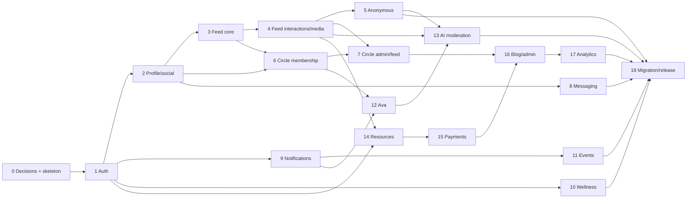

# NotOnlyHere Implementation Plan

**Status:** Proposed implementation baseline
**Product:** Authenticated web application and web admin panel
**Last updated:** 2026-07-29
**Companion documents:** [Product PRD](./01-product-prd.md), [UX specification](./02-ux-spec.md), [Technical design](./03-tech-design.md), [Backend schema](./04-backend-schema.md), [Testing plan](./06-testing-plan.md)

The [Product PRD](./01-product-prd.md) is authoritative for scope and product intent; [02](./02-ux-spec.md) is authoritative for interaction behavior; [03](./03-tech-design.md) and [04](./04-backend-schema.md) govern architecture and data. Every implementation ticket cites the applicable PRD requirement IDs and UX flow/screen. Open product or policy decisions are tracked explicitly and do not permit implementers to invent excluded capabilities.

## 1. Delivery strategy

NotOnlyHere will be delivered through thin, end-to-end tracer-bullet slices. Each slice starts with one failing behavior-focused test at an agreed public seam, adds the minimum schema/API/UI or admin/jobs work needed to make it pass, and ends in an independently demoable state.

This plan deliberately avoids horizontal phases such as “build the backend” or “build all screens.” A phase may establish reusable infrastructure only when a user-visible path exercises it in that same phase.

### 1.1 Principles

1. **Durable decisions first.** Resolve identity, authorization, privacy, retention, external adapter, event, and migration decisions before features depend on them.
2. **One red-to-green slice at a time.** A phase can contain several slices, but each slice is integrated and green before the next starts.
3. **Public seams are contracts.** Browser routes, REST resources, Socket.IO events, background-job effects, adapter interfaces, database constraints, and admin authorization are documented before implementation and tested as behavior.
4. **External boundaries are replaceable.** Stripe, OpenAI, Resend, S3/R2, Apple, and Google are accessed only through typed adapters.
5. **Privacy is structural.** Anonymous identity, AI history, blocks, deletion, and admin traceability are enforced in query/service boundaries, not only hidden in UI.
6. **Every phase is reversible.** Additive migrations, disabled navigation, configuration switches, and worker pause/drain procedures support rollback.
7. **Web only.** No native app, app-store flow, push notifications, or app download surface is introduced.

## 2. Assumptions and prerequisites

### 2.1 Assumptions

- The existing static landing site remains visually and operationally separate from the authenticated application. Its design is out of scope except for login, registration, blog, and donation integration.
- The authenticated web application uses Next.js 15, React 19, TypeScript, and Tailwind CSS.
- The API and workers use NestJS, PostgreSQL with Prisma, Redis, Socket.IO, S3-compatible object storage, OpenAI, Resend, and Stripe.
- A monorepo is preferred unless [03](./03-tech-design.md) specifies otherwise: `apps/web`, `apps/api`, optional `apps/worker`, and shared contract/config packages.
- REST under `/api/v1` is the durable request/response interface. Socket.IO accelerates delivery but does not replace persisted REST history.
- PostgreSQL is the system of record. Redis is ephemeral infrastructure for cache, presence-like connection state, rate limiting, and queues; loss of Redis must not lose durable user content.
- Times are stored in UTC and rendered in the user’s browser locale. Event timezone semantics must be explicitly selected during Phase 0.
- Accessibility target is WCAG 2.2 AA for user and admin web surfaces.
- Crisis help is static disclaimer/resource content. There is no automated crisis detection.
- “Provider no-training” means the selected OpenAI account/API terms and request configuration prohibit provider training on customer content; this must be contractually verified, not inferred from code.
- Structured application logs and platform metrics are the observability baseline. Sentry and PostHog are excluded.

### 2.2 Prerequisites

- Approved versions of [01](./01-product-prd.md)–[04](./04-backend-schema.md), including stable requirement IDs.
- Approved user-facing community guidelines, privacy policy, terms, AI disclosure/consent copy, deletion/retention policy, age-16 attestation language, crisis resources, and donation terms.
- Google and Apple OAuth applications with local/staging/production redirect URIs.
- Separate development, test, staging, and production credentials for Postgres, Redis, S3/R2, OpenAI, Resend, and Stripe.
- Domain, TLS, email sender-domain verification, DNS ownership, and a documented static-site routing owner.
- Admin role owners and seed procedure; no shared administrator account.
- BuddyBoss export sample, data dictionary, media archive, and permission to process it.
- Browser and responsive support matrix approved in [02](./02-ux-spec.md).
- Backup, restoration, retention, and production access owners identified.

## 3. Durable decisions to approve before feature work

Record outcomes as architecture decision records and update [03](./03-tech-design.md) and [04](./04-backend-schema.md).

| ID | Decision | Proposed default | Why it is durable |
|---|---|---|---|
| DD-01 | Deployment topology | Next.js web, NestJS API/worker, managed Postgres/Redis/object storage | Changes routing, cookies, CORS, scaling, and operations |
| DD-02 | Auth/session model | Secure, HttpOnly, SameSite cookies; 15-minute access session plus rotating refresh-token family with 30-day inactivity/90-day absolute limits, hashed tokens, reuse detection, and CSRF protection | Affects every browser/API interaction |
| DD-03 | OAuth account linking | Link only after verified provider email or explicit authenticated confirmation; prevent silent collisions | Prevents account takeover and duplicates |
| DD-04 | User identifiers | Application-generated UUIDv7 primary keys; mutable unique normalized username and email | Migration, URLs, audit, and anonymity depend on this |
| DD-05 | Authorization | Central policy service with object guards and granular permissions; global roles Super Admin, Moderator, Content Editor, and Analyst; scoped circle roles Member and Circle Admin only | Avoids endpoint-specific authorization drift |
| DD-06 | Anonymous identity | Separate typed anonymous-author record per post/comment; creator linkage is restricted and never serialized to member APIs | Identity leakage is high impact |
| DD-07 | Anonymous pseudonyms | Generated per anonymous contribution unless [01] says otherwise; no consistency promise | Consistent aliases are explicitly excluded |
| DD-08 | Block semantics | Block prevents connection creation, DMs, and direct discovery/interactions as defined in PRD; existing DM thread becomes non-sendable | Must be consistent across modules |
| DD-09 | Content deletion | Soft-delete community content with tombstones; account deletion uses defined purge/anonymization schedule | Referential integrity and privacy |
| DD-10 | Events/outbox | Transactional outbox in Postgres, idempotent workers, stable event IDs | Notifications, email, analytics, and webhooks rely on it |
| DD-11 | Realtime protocol | Versioned Socket.IO namespace/events; server sequence/cursor; reconnect always reconciles via REST | Prevents loss/duplication assumptions |
| DD-12 | Media | Presigned upload, server-finalized asset record, allowlisted MIME/size/dimensions, asynchronous metadata checks | Security and storage portability |
| DD-13 | Search | Start with PostgreSQL full-text/trigram search and explicit indexes | Avoids premature search infrastructure |
| DD-14 | Rate limits | Server-side Redis limits with durable usage where billing/safety requires it; stable error envelope | Anonymous and AI quotas are contractual |
| DD-15 | API conventions | `/api/v1`, OpenAPI, cursor pagination, RFC 7807-style errors, UUIDv7 IDs, version/ETag concurrency, idempotency key on selected writes | Public seam consistency |
| DD-16 | AI data boundary | Explicit consent gates personality preferences; private deletable history; minimized prompts; no provider training | Privacy and legal dependency |
| DD-17 | Payments | Stripe Checkout/Payment Links or Checkout Sessions with webhook-authoritative status; no card data on NotOnlyHere servers | Financial correctness and PCI scope |
| DD-18 | Analytics | First-party append-only events with documented taxonomy and consent/legal basis; no PostHog | Product metrics and privacy |
| DD-19 | Tenant model | Single NotOnlyHere community; circles are resources, not tenants | Determines authorization and keys |
| DD-20 | Time and scheduling | UTC instants plus source timezone; durable queue with idempotent schedule keys | Blog publishing and reminders |
| DD-21 | Audit | Append-only admin/security audit records with actor, action, target, before/after metadata, request ID | Admin accountability |
| DD-22 | Static-site integration | Same canonical domain with explicit route ownership and shared login state/links | Avoids route and cookie conflicts |
| DD-23 | Migration identity | Source-system IDs stored in mapping table; rerunnable imports keyed by source/type/ID | Makes BuddyBoss import recoverable |
| DD-24 | Feature exposure | Deploy dark using server configuration and navigation gates, not a full product feature-flag system | Supports rollout without adding excluded feature flags |

### 3.1 Scope guardrails

Included behavior is limited to the canonical scope. In particular:

- No 2FA, profile privacy/preferences/badges, content warnings, mentions, hashtags, pinning, user reports, native/mobile app, or push notifications.
- No anonymous DMs, anonymous profile link, consistent anonymous alias guarantee, or toxicity scan.
- No circle events, member-facing featured-circle module, or Circle Moderator role. Global admins may retain an audited administrative curation flag without exposing a featured-circles experience.
- Messaging is connection-only 1:1 text with emoji reactions; no receipts, typing, files, reports, groups, or voice.
- AI has no automated crisis detection, summarization, journal prompts, or admin configuration. Static crisis resources remain visible.
- Notifications have no digest, mute, or preference center. Circle mute is a circle-feed behavior, not a notification preference system.
- Resources have no builder, quiz, downloadable PDF, or certificate.
- Stripe supports donations and one-time-paid resources only; there are no core subscriptions or feature paywalls.
- Admin has no user-report queue, AI configuration, or product feature-flag console.
- Analytics excludes circle-health and moderation analytics.
- A circle mute is a Circle Admin’s scoped, reasoned, policy-defined restriction on a member’s posting/commenting. It is not a member preference or a way to hide a circle.

Any request that crosses these boundaries requires a PRD change, privacy/security review, revised tests, and plan update before implementation.

## 4. Discovery and migration spikes

### 4.1 BuddyBoss export spike

Use a read-only export copy. Do not import personal data into developer laptops without approved handling.

**Questions to answer**

- Which entities are exportable: users, profile fields, friendships, groups/memberships, activity posts/comments/reactions, messages, media, blog content, donations, roles, blocks?
- What stable source IDs, timestamps, soft-delete states, visibility values, and author references exist?
- Which content can legally and product-wise migrate, especially private messages and anonymous-looking content?
- How are deleted/banned users, orphaned media, malformed HTML, duplicate emails/usernames, timezone values, and unavailable files represented?
- Can passwords be migrated safely? Default assumption: no; issue password reset/account-claim flow.

**Deliverables**

- Redacted inventory and row/media counts.
- Source-to-target mapping aligned with [04](./04-backend-schema.md).
- Transformation rules and unsupported-field report.
- Rerunnable import harness design using source ID maps, checkpoints, dry-run, reject file, and checksums.
- Reconciliation queries for count, referential integrity, samples, permissions, and media hashes.
- Estimated operational size/risk (not calendar duration), cutover options, rollback, and deletion of export artifacts.

**Acceptance**

- Two successive dry runs produce identical target state and reject report.
- Unsupported content is explicitly approved for omission.
- A sampled user’s visible content and permissions match approved expectations.

### 4.2 Static-site integration spike

**Questions to answer**

- Is the static site hosted at the apex domain, a subdomain, or behind the same edge router?
- Which owner serves `/login`, `/register`, `/blog`, `/support`, authenticated app routes, and error pages?
- How are return URLs, OAuth callbacks, session cookies, CSP, canonical links, RSS, and cache invalidation handled?
- Does existing static markup meet accessibility and responsive integration requirements?

**Deliverables and acceptance**

- Route ownership table and redirect map, including removal/redirect of `/download`.
- A deployed staging flow: landing page → register/login → authenticated home → logout → landing.
- Blog and donation links cross the boundary without mixed environments or session leakage.
- No App Store, Play Store, or native-app messaging appears.

## 5. Phased vertical-slice plan

Relative size: **S** = narrow slice, **M** = several coordinated behaviors, **L** = broad/high-risk domain slice. Size is complexity, not a calendar estimate.

### Phase 0 — Decisions and executable walking skeleton (M)

**Goal and demo:** Approve DD-01–DD-24 and deploy one authenticated placeholder path through browser, API, database, structured logs, and CI to staging. Demo `/app` returning the signed-in test user from `/api/v1/account`.

**Work**

- Schema/API: baseline Prisma migration, health/readiness endpoints, user/session skeleton, OpenAPI/error envelope.
- UI/admin/jobs: Next.js app shell, accessible navigation, error boundary; admin shell hidden except to seeded admin; worker consumes one no-op outbox event.
- Security/observability: secrets/config validation, secure headers/CSP baseline, request IDs, redaction rules, JSON logs, service/queue/database metrics.
- Tests: first Playwright login-stub walking path, API integration test with real Postgres, migration-up test, outbox consume test.

- **Dependencies:** Approved environment and topology.
- **Entry:** Prerequisites owners identified.
- **Exit/acceptance:** Staging deploy is reproducible; readiness reflects dependencies; browser/API/worker correlation ID is traceable; public seams are proposed and reviewed.
- **Rollback:** Remove app route from edge and roll back empty baseline deployment; retain additive migration.
**Primary risk:** Building infrastructure not exercised by a real path. Mitigation: reject any component not used by the walking skeleton.

### Phase 1 — Registration, verification, login, and session safety (L)

**Goal and demo:** A person aged 16+ registers with email/password, verifies email, logs in/out, resets a password, views/revokes sessions, or signs in with Google/Apple.

**Work**

- Schema/API: users, credentials, OAuth identities, verification/reset tokens, rotating session families/sessions, age/terms/privacy attestations; `/api/v1/auth/*` and account session endpoints.
- UI: static-site login/register integration, verification/reset states, session management, accessible errors.
- Admin/jobs: verification/reset emails through outbox/Resend; minimal user lookup for bootstrap admin only.
- Security/observability: Argon2id/bcrypt parameters approved, generic account-recovery responses, token hashing/expiry/single use, OAuth state/PKCE/nonce, CSRF, cookie rotation, login throttles and audit.
- Tests: age rejection, duplicate/case-normalized identity, token replay, session revocation, OAuth linking collision, email idempotency.

- **Dependencies:** Phase 0; OAuth and email credentials.
- **Entry:** Auth/session/account-linking seams approved.
- **Exit/acceptance:** All demo paths work on staging; revoked session immediately fails; no secret/token appears in logs; accessibility smoke passes.
- **Rollback:** Disable new registration/social providers independently; existing session validation remains compatible.
**Primary risk:** Account takeover via linking or recovery. Require focused threat-model review.

### Phase 2 — Profile, connections, blocks, activity, and deletion request (M)

**Goal and demo:** A member edits a basic profile, sends/accepts/removes a connection, views allowed activity, blocks another user, requests an account-wide data export, and requests account deletion.

**Work**

- Schema/API: avatar, cover, display name, unique username, bio, join date, connection state machine, blocks, activity projection, account-export job/status/download, deletion request/status.
- UI: own/public profile, crop/confirm avatar and cover upload, connection controls, blocked states, activity list, data export queued/ready/expired states, deletion confirmation/status.
- Admin/jobs: encrypted account-export generation/expiry; deletion queue/status view; purge/anonymization job initially exercises a seeded disposable account.
- Security/observability: field allowlists, block policy centralized, no blocked-user activity leakage, re-authentication for deletion, audit and deletion metrics.
- Tests: crossed connection requests converge, block wins over connection/DM eligibility, profile authorization, account-export isolation/expiry/idempotency, deletion idempotency and retention outcomes.

- **Dependencies:** Phase 1.
- **Entry:** Profile fields and deletion policy approved.
- **Exit/acceptance:** Two-account demo proves connect/block/export/delete; export contains only requesting-user data and expires; API and UI agree; purge dry run reconciles affected records.
- **Rollback:** Hide social controls; additive records remain; pause deletion worker without losing requests.
**Primary risk:** Ambiguous block/deletion semantics across later modules. Freeze policy tests now.

### Phase 3 — Feed publication tracer bullet (M)

**Goal and demo:** A member creates a text post under Public, Members, Connections, or Only me visibility; switches Relevant/Chronological feed mode for the current browser session; sees cursor pagination; edits within 15 minutes; and soft-deletes it.

**Work**

- Schema/API: posts, four-way visibility policy plus separate circle context, deterministic Relevant/Chronological ordering, explicit mode request parameter, feed cursor, 15-minute edit metadata, soft-delete tombstone. The client retains the mode only for the current browser session.
- UI: composer, feed card, empty/loading/error states, infinite scroll first page/continuation, edit/delete.
- Admin/jobs: admin content lookup only for operational diagnosis with audit.
- Security/observability: server-derived author, visibility filtering in query layer, sanitized text/link handling, feed latency/error metrics.
- Tests: visibility combinations, stable cursor under concurrent inserts, edit/delete authorization, tombstone behavior.

- **Dependencies:** Phases 1–2.
- **Entry:** Visibility vocabulary and pagination contract approved.
- **Exit/acceptance:** Three seeded users prove visibility boundaries; no duplicate/missing feed item during continuation test.
- **Rollback:** Disable composer/feed route; retain posts for forward fix.
**Primary risk:** Visibility leakage due to post-filtering. Require database query-level policy tests.

### Phase 4 — Feed media, links, comments, reactions, search, and filters (L)

**Goal and demo:** A member posts up to four approved images or an editable/removable link preview, comments or replies one level deep, chooses one of Support/Hug/Insightful, searches, filters, and continues an infinite feed with a Load more fallback.

**Work**

- Schema/API: media assets/attachments, link previews, comments, reaction uniqueness, search indexes and filters.
- UI: presigned upload/finalize, image alt text, safe link card, nested depth per [02], reaction controls, search/filter states.
- Admin/jobs: orphan media cleanup and link-preview fetch worker.
- Security/observability: SSRF-resistant preview fetcher, MIME/signature/size checks, image metadata stripping decision, signed object access, sanitized URLs, upload/search metrics.
- Tests: duplicate reactions converge, comment authorization/soft-delete, bad upload, inaccessible object, SSRF targets, search permissions and cursor stability.

- **Dependencies:** Phase 3, S3/R2.
- **Entry:** Media limits and comment model approved.
- **Exit/acceptance:** Text/image/link paths work; private content never appears in search; failed preview does not prevent post publication.
- **Rollback:** Disable uploads/preview/search independently; text feed remains available.
**Primary risk:** Unsafe remote fetching and storage abuse.

### Phase 5 — Anonymous posts and comments (M)

**Goal and demo:** A member creates anonymous posts/comments under a generated pseudonym, sees the daily remaining quota, and cannot be identified by other members; an authorized admin can trace identity with audit.

**Work**

- Schema/API: anonymous presentation/identity mapping, atomic 10/day quota, admin trace endpoint.
- UI/admin: anonymous toggle and explanation, generated pseudonym display, quota error; tightly scoped trace action with reason confirmation.
- Jobs: quota storage/expiry strategy; no toxicity scanning.
- Security/observability: serializer denylist, separate query DTOs, no creator IDs in URLs/cache/logs/analytics/Socket.IO, trace audit and alert metrics.
- Tests: identity leak snapshots across all public seams, quota race at boundary, timezone/day reset, no anonymous profile link/DM action.

- **Dependencies:** Phases 3–4 and admin authorization skeleton.
- **Entry:** DD-06/DD-07 and trace-role policy approved.
- **Exit/acceptance:** Red-team identity-leak suite is green; 11 concurrent requests create at most 10 anonymous contributions.
- **Rollback:** Disable anonymous creation; existing anonymous content stays anonymous and readable.
**Primary risk:** Irreversible identity disclosure. Treat any leak as release blocking.

### Phase 6 — Circles directory and membership (M)

**Goal and demo:** A member browses/searches circles, views eligible details/member lists, joins an open circle or requests approval, accepts/declines an invite, and leaves without violating the last-Circle-Admin invariant.

**Work**

- Schema/API: separate public/private/hidden visibility and open/approval/private join policy, membership states, invites, directory/search/detail/member-list.
- UI: directory/detail, join/request/invite/leave flows, membership state, member list, hidden/private states.
- Admin/jobs: invite expiry and approval notification events.
- Security/observability: private-circle discovery rules, invite token hashing, membership policy guard, join funnel metrics.
- Tests: visibility × join-policy matrix, duplicate/crossed joins, expired invite, last-admin leave, and non-member/hidden-circle visibility.

- **Dependencies:** Phases 2–3 and notifications outbox foundation.
- **Entry:** Circle privacy/member-list semantics approved.
- **Exit/acceptance:** Open, approval, and private circle demos pass with independent users.
- **Rollback:** Disable circle creation/join while preserving read-only directory.
**Primary risk:** Private circle/member disclosure.

### Phase 7 — Circle creation, administration, and circle feed (L)

**Goal and demo:** An eligible member creates or submits a circle for global approval, becomes Circle Admin, approves/removes members, applies a reasoned scoped member mute, manages visibility/join policy/invites, removes a circle post with reason, and members publish/read circle posts.

**Work**

- Schema/API: circle creation/approval policy, role assignment, membership administration, member mutes, audited post removal, circle-scoped post visibility.
- UI/admin: create/edit circle, approval queue, remove/invite/mute controls, reason dialogs, circle feed/composer; global approve/archive/administrative-feature controls.
- Jobs: membership/invite notifications via outbox.
- Security/observability: last-admin invariant, role transition audit, removed-member access revocation, per-circle action metrics without “circle health” analytics.
- Tests: circle-admin versus platform-admin matrix, concurrent approval/removal, last-admin protection, removed member cannot read/feed/search.

- **Dependencies:** Phases 4 and 6.
- **Entry:** Circle creation eligibility and defaults approved.
- **Exit/acceptance:** Full create→join approval→post→mute/remove flow works; no Circle Moderator role is exposed.
- **Rollback:** Disable circle creation/admin mutations; existing circle feeds remain readable according to policy.
**Primary risk:** Distributed authorization between generic feed and circles.

### Phase 8 — Connection-only direct messaging (L)

**Goal and demo:** Connected members exchange 1:1 text messages in near real time, reload history, search it, reconnect without loss, and add emoji reactions; blocking immediately prevents sending.

**Work**

- Schema/API: canonical one-thread-per-user-pair, messages, reactions, history/search cursors.
- UI: inbox/thread, send state, reconnect banner, history/search, emoji reactions; no typing/read receipt/file controls.
- Realtime/jobs: versioned Socket.IO auth/join/send/ack events, persisted-before-emit, REST reconciliation.
- Security/observability: connection/block policy on every read/write/socket join, message size/sanitization, socket rate limits, connection/ack/reconnect metrics without message bodies.
- Tests: concurrent thread creation, message idempotency, order/cursor, reconnect/dedupe, revoked session, block during active socket.

- **Dependencies:** Phases 2 and 0 realtime decision.
- **Entry:** Socket.IO public protocol approved.
- **Exit/acceptance:** Two browsers exchange/search/reload messages with no loss or duplicate; disconnected client catches up.
- **Rollback:** Disable socket transport and/or sending; REST history remains readable.
**Primary risk:** Treating realtime delivery as durability.

### Phase 9 — In-app/email notifications and broadcasts (M)

**Goal and demo:** A member receives an in-app notification and applicable event email for comment, reaction, connection, DM, circle invite, or admin action; an authorized admin sends a broadcast with audience summary, preview, confirmation, and audited delivery.

**Work**

- Schema/API: notification inbox, read state, outbox/delivery attempts, broadcast audience/snapshot.
- UI/admin: notification center/unread count, deep links; broadcast compose/preview/send/status.
- Jobs: idempotent fan-out, Resend adapter, retry/dead-letter handling.
- Security/observability: safe templates/deep links, no recipient leakage, admin RBAC, delivery/failure/lag metrics and redacted logs.
- Tests: duplicate outbox consumption, retry, invalid email, read concurrency, broadcast authorization and immutable recipient snapshot.

- **Dependencies:** Phase 1 and event producers from prior phases.
- **Entry:** Event-to-channel matrix and email copy approved.
- **Exit/acceptance:** A single domain event creates one logical notification/email despite retries.
- **Rollback:** Pause email worker; in-app notifications continue and queued email is retained or explicitly expired.
**Primary risk:** Duplicate or unintended broadcast delivery.

### Phase 10 — Wellness mood check-ins and trends (M)

**Goal and demo:** A member records or updates at most one local-day mood of 1–5 with optional note, then views private 7-day and 30-day trends with missing days shown as gaps.

**Work**

- Schema/API: one check-in per user local date, same-day update, encrypted note, and 7/30-day aggregation.
- UI: accessible mood control, optional note, history/trend chart with nonvisual summary.
- Admin/jobs: no mood-content admin browsing; only operational aggregate counts if approved.
- Security/observability: owner-only access, no notes in logs/analytics, timezone boundaries, query latency metrics.
- Tests: range validation, date boundaries/DST, empty/sparse data, owner isolation, chart accessibility.

- **Dependencies:** Phase 1.
- **Entry:** Local-day/timezone and note-retention policy approved.
- **Exit/acceptance:** Two-user isolation and 7/30 calculations match fixtures; no streak/reminder/export/journal UI.
- **Rollback:** Hide feature and retain private entries per policy.
**Primary risk:** Sensitive-note leakage into analytics/support tooling.

### Phase 11 — Standalone events, RSVP, calendar, and reminders (M)

**Goal and demo:** Authorized staff creates a standalone event under the conservative release policy; members RSVP Going/Maybe/Not going, browse equivalent Month/List views, and receive reminder emails once at 24 hours and 1 hour.

**Work**

- Schema/API: events, timezone, Going/Maybe/Not going RSVP uniqueness/state, month/list query ranges, and two idempotent reminder occurrences per eligible RSVP.
- UI: create/detail/calendar/RSVP with timezone clarity.
- Admin/jobs: scheduled reminder scan/enqueue/send; event lookup/admin actions per policy.
- Security/observability: creator/admin mutation policy, enumeration protection, schedule idempotency, lag/missed-reminder metrics.
- Tests: RSVP race, DST/timezone, event changes/cancellation, late creation, duplicate worker runs.

- **Dependencies:** Phases 1 and 9.
- **Entry:** Event creation eligibility and cancellation semantics approved.
- **Exit/acceptance:** Reminders are exactly once logically under worker retry; no virtual link, recurrence, or circle linkage fields appear.
- **Rollback:** Stop creation/reminders independently; preserve event read/RSVP state.
**Primary risk:** Timezone and rescheduling mistakes.

### Phase 12 — Ava private chat and opt-in recommendations (L)

**Goal and demo:** A logged-in, in-quota member chats privately with Ava, sees conversation starters/static crisis resources, deletes history, and separately opts in to circle recommendations.

**Work**

- Schema/API: AI conversations/messages, atomic 50 accepted member messages per UTC calendar day, consent records/version, recommendation output, deletion.
- UI: disclosure and static crisis resources, starters, chat/error/retry/quota states, history/delete, recommendation opt-in.
- Jobs/adapters: OpenAI adapter with timeout/circuit breaker; optional asynchronous title prohibited unless PRD allows; deletion reconciliation.
- Security/observability: prompt minimization, provider no-training verification, prompt-injection boundaries, no tool access by default, encrypted/private storage, no transcript logs, usage/token/error metrics.
- Tests: consent and owner isolation, quota races, provider timeout/refusal/malformed response, prompt injection, deletion, opt-in withdrawal.

- **Dependencies:** Phases 1, 6, and 9; legal/provider approval.
- **Entry:** AI disclosure, consent, retention, model, and provider terms approved.
- **Exit/acceptance:** Chat and recommendation can be disabled separately; deleted history disappears from user/API and follows retention policy; no automated crisis classifier exists.
- **Rollback:** Disable provider calls while preserving deletion/history access and static resources.
**Primary risk:** Sensitive data sent beyond approved purpose.

### Phase 13 — AI moderation flags and limited safety alerts (M)

**Goal and demo:** Submitted in-scope community content can produce an AI moderation flag; authorized admins see limited safety alerts and record disposition. No automatic user sanction occurs.

**Work**

- Schema/API: moderation evaluation/flag/disposition linked to content and model/version.
- UI/admin: limited alert list/detail/disposition, content status; no user-report queue or AI config.
- Jobs/adapters: asynchronous moderation request with retries and dedupe.
- Security/observability: least-content prompts, strict admin role, no automated enforcement, model/error/queue metrics, audited views/dispositions.
- Tests: provider failure leaves content policy-defined state, duplicate evaluations, stale/deleted content, authorization, adversarial payload handling.

- **Dependencies:** Phases 4, 5, 12, and admin RBAC.
- **Entry:** What is flagged, who sees it, retention, and human response process approved.
- **Exit/acceptance:** Flag→admin disposition is traceable; provider outage does not silently punish or expose users.
- **Rollback:** Pause evaluator and hide alert navigation; preserve audit records.
**Primary risk:** Overclaiming safety or silently automating enforcement.

### Phase 14 — Resource library and progress (L)

**Goal and demo:** Authenticated members search and view eligible articles/videos/worksheets, record progress, and receive the correct members-only or one-time-paid access. Public resource reads remain disabled under the conservative OQ-06 default.

**Work**

- Schema/API: resource metadata/type/access tier, content asset, search, entitlement, progress.
- UI/admin: library/search/detail/viewer/progress; minimal resource CRUD if [01] assigns it to admin.
- Jobs: media processing/link checks where needed.
- Security/observability: server-side entitlement, signed URLs, no downloadable-PDF promise, XSS-safe content, search/view/progress metrics.
- Tests: access-tier matrix, progress idempotency, signed URL expiry, search visibility, unsupported content type rejection.

- **Dependencies:** Phases 1 and 4 storage; paid entitlement completed with Phase 15.
- **Entry:** Resource formats, authoring source, and “progress” semantics approved.
- **Exit/acceptance:** Authenticated member paths are complete; paid resource is dark until payment slice passes; public resource routes are absent unless OQ-06 is approved. No quiz/certificate/builder controls.
- **Rollback:** Disable new access by tier; retain progress and entitlements.
**Primary risk:** Accidental paywall of core community or object URL leakage.

### Phase 15 — Stripe donations and paid-resource purchase (L)

**Goal and demo:** A visitor/member makes a one-time donation, starts/cancels a monthly donation, or buys one resource; webhook-authoritative state appears in user/admin views.

**Work**

- Schema/API: checkout intents, donations, recurring donation references/status, purchases/entitlements, processed webhook event IDs.
- UI/admin: donation and paid-resource checkout return/cancel states, receipts/status; admin donation lookup/export as scoped.
- Jobs/adapters: Stripe Checkout and signed webhook handler; reconciliation task.
- Security/observability: webhook signature/raw body, idempotency, amount/currency allowlists, no card storage, finance audit and mismatch metrics.
- Tests: duplicate/out-of-order webhooks, abandoned checkout, refund/dispute/cancellation semantics, amount tampering, entitlement grant/revoke policy.

- **Dependencies:** Phases 1, 14, and admin shell; Stripe account.
- **Entry:** Donation amounts/currencies, recurring cancellation, refund, tax/receipt, guest-donor, and paid-resource refund policies approved.
- **Exit/acceptance:** Replaying all webhook fixtures is idempotent; Stripe reconciliation has zero unexplained differences. Core community remains unpaywalled.
- **Rollback:** Disable checkout creation; continue accepting webhooks and showing existing status.
**Primary risk:** Granting entitlement from browser return rather than signed webhook.

### Phase 16 — Blog publishing and operational admin panel (L)

**Goal and demo:** Public/static-site visitors browse blog list/post/category/tag/related/RSS; Content Editors operate blog and resource content; Moderators review permitted safety/user actions; Analysts view aggregates; Super Admins operate users, roles, circles, donations, and audit.

**Work**

- Schema/API: blog posts/status/schedule/categories/tags and RSS; optimistic versioning without a separate revision-history feature; four fixed global role bundles; user search plus transactional suspension/ban/restore history and session revocation; Super-Admin-only role assignment with last-Super-Admin protection; circle approve/archive/admin-feature; donation views; immutable audit.
- UI/admin: integrated public blog, editor/preview/schedule, dashboard summary, users/enforcement history, circles, blog, donation, audit, and fixed-role assignment screens. No custom role/permission editor is created.
- Jobs: idempotent scheduled publication and cache invalidation.
- Security/observability: HTML sanitization, preview token, schedule timezone, RBAC per action, audit before/after, publication and admin-action metrics.
- Tests: draft/scheduled/published visibility, schedule race, RSS escaping, slug collision, complete Moderator/Content Editor/Analyst/Super Admin negative-path matrix, last-Super-Admin protection, audit immutability.

- **Dependencies:** Phases 1, 6–7, 15, and static integration spike.
- **Entry:** Editorial workflow and exact admin actions approved.
- **Exit/acceptance:** Schedule publishes once; public routes integrate with static site; no product SEO manager or author profile appears.
- **Rollback:** Pause scheduler and serve last published content; disable individual admin mutations.
**Primary risk:** Broad admin privileges hidden behind a single coarse role check.

### Phase 17 — First-party analytics and export (M)

**Goal and demo:** Analysts/Super Admins view PRD-defined DAU/MAU, activation/retention, contribution, and visit→register→first post→join circle metrics and export the same governed definitions.

**Work**

- Schema/API: versioned event taxonomy, append-only event ingestion, aggregate queries/materialization, export job/status/download.
- UI/admin: analytics overview, date filters, funnel, export request/status.
- Jobs: event consumption, aggregation, expiring signed export.
- Security/observability: pseudonymous/minimized properties, consent/legal basis, admin-only export, formula/version metadata, freshness/lag metrics.
- Tests: event dedupe, late/out-of-order events, funnel definitions, timezone ranges, export authorization/expiry, deletion treatment.

- **Dependencies:** Stable events from Phases 1–16.
- **Entry:** Metric dictionary, event taxonomy, retention, and deletion rules approved.
- **Exit/acceptance:** Dashboard numbers reconcile with SQL fixtures and export; no moderation/circle-health analytics.
- **Rollback:** Stop event collection/aggregation; product behavior is unaffected.
**Primary risk:** Collecting sensitive content or presenting misleading metric definitions.

### Phase 18 — Migration, hardening, and release (L)

**Goal and demo:** A rehearsal imports approved BuddyBoss data, the full product passes release gates, and production rollout/rollback is exercised.

**Work**

- Schema/API/UI/admin/jobs: finalize rerunnable importers, account-claim/reset flow, legacy redirects, reconciliation dashboard/report, operational runbooks.
- Security: full threat review, dependency/container scan, secrets rotation rehearsal, privacy/deletion verification, abuse/rate-limit review, admin access review.
- Observability: production dashboards/alerts for availability, latency, errors, queue lag, email, sockets, AI, payment, storage, and migration reconciliation.
- Tests: two successful production-scale migration rehearsals with deterministic reconciliation, backup restore, load/soak, browser/responsive/accessibility, failure injection, smoke and rollback drill per [06](./06-testing-plan.md).

- **Dependencies:** All prior phases and completed spikes.
- **Entry:** Feature acceptance complete; migration dataset approved; support/on-call owners trained.
- **Exit/acceptance:** Release gates in Section 9 pass; go/no-go signed; rollback and restore evidence retained; source export securely destroyed on schedule.
- **Rollback:** Route users to maintenance/read-only or prior compatible release, stop import writers, restore only from verified pre-cutover backup if forward correction is unsafe. Never blindly reverse a migration after user writes.
**Primary risk:** Migration changes authorization/privacy semantics. Reconcile permissions and sample private data, not only row counts.

## 6. Dependency graph

Some phases can proceed in parallel after their dependencies are stable, but each branch must continue to integrate into the same staging environment and contract suite.

## 7. Cross-cutting implementation rules

### 7.1 Schema and migrations

- Prefer additive expand/migrate/contract changes. Do not combine destructive schema contraction with the code release that stops using a field.
- Every migration has forward verification, rollback/forward-fix notes, lock/size assessment, and production backup prerequisite.
- Express uniqueness, foreign keys, non-null, check constraints, and idempotency in PostgreSQL where possible; do not rely only on UI validation.
- Prisma migrations and raw SQL constraints/indexes are reviewed against [04](./04-backend-schema.md).

### 7.2 API and contracts

- Generate and review OpenAPI for REST. Validate request and response DTOs and reject unknown sensitive fields.
- Use stable machine error codes with safe human messages and request IDs.
- Use cursor pagination for mutable collections; never expose anonymous creator IDs or provider secrets.
- Mutations that clients may retry use an idempotency key or resource uniqueness strategy.

### 7.3 UI and accessibility

- Follow [02](./02-ux-spec.md) for routes, interaction states, responsive behavior, content, and design tokens.
- Every slice includes loading, empty, success, validation, permission, rate-limit, and recoverable failure states relevant to the path.
- Keyboard access, visible focus, semantic labels, live-region announcements, reduced motion, contrast, zoom/reflow, and nonvisual chart equivalents are acceptance concerns, not later polish.

### 7.4 Jobs and external systems

- Domain change and outbox event commit atomically. Workers are at-least-once and handlers idempotent.
- Retry only transient failures with bounded exponential backoff and jitter; record terminal failure for operator action.
- Adapter contracts normalize timeouts, errors, idempotency identifiers, and redaction.
- No job log contains post/comment/message/AI/mood text or reset/invite/payment tokens.

### 7.5 Security and privacy

- Maintain a living threat model for account recovery/linking, anonymous identity, media/SSRF, sockets, AI prompts, admin actions, webhooks, and migration.
- Default-deny authorization at REST, socket rooms/events, object URLs, search, exports, and admin routes.
- Data classification and retention are fields in schema/design reviews. Production data is prohibited in routine test environments.
- Static crisis resources and “not therapy/not emergency care” disclosures are consistently visible where [01]/[02] require them. No automated crisis detection is implemented.

### 7.6 Observability

- Structured logs include timestamp, level, service, environment, request/event/job ID, route/event name, safe actor ID, duration, result, and error class.
- Redact credentials, cookies, tokens, email message bodies, community content, DMs, mood notes, AI transcripts, and payment payload secrets.
- Platform/application metrics cover request rate/error/latency, database pool/query health, Redis, queue depth/age/retries/dead letters, Socket.IO connections/acks, email delivery, object storage, AI errors/tokens, Stripe webhook reconciliation, and scheduler lag.
- Alerts must map to an owner and runbook. Product analytics is not an operational error tracker.

## 8. Definition of Ready and Definition of Done

### 8.1 Definition of Ready for a slice

- Requirement and generic trace ID are linked to [01](./01-product-prd.md); unresolved conflict is recorded.
- UX states and accessibility expectations are linked to [02](./02-ux-spec.md).
- Public seam request/event/schema and authorization table are proposed and reviewed.
- Data classification, retention/deletion, migration, and audit impact are known.
- External dependency contract and sandbox credentials exist if needed.
- One smallest behavior-focused failing test and user-visible demo script are named.
- Dependencies, rollout/rollback, observability, and acceptance checks are explicit.
- Exclusions are called out so adjacent behavior is not accidentally added.

### 8.2 Definition of Done for a slice

- The failing test was observed red for the intended reason, is green, and relevant regression suites pass.
- Browser/API/socket/job behavior is integrated with real Postgres/Redis where relevant; only external systems are mocked in normal integration tests.
- Authorization, privacy, concurrency/idempotency, rate-limit, failure, accessibility, and observability cases appropriate to the slice pass.
- Schema migration and generated OpenAPI/contracts are reviewed and reproducible.
- Structured logs/metrics are safe and useful; no sensitive fixture/content leakage.
- User/admin documentation, runbook, decision record, and traceability are updated.
- Acceptance demo runs in staging with production-like routing.
- Rollback or safe disablement is rehearsed in proportion to risk.
- No excluded UI/API/schema capability was introduced.

## 9. Release gates

Production go/no-go requires:

1. All in-scope PRD requirements trace to passing automated tests and accepted UAT; all deviations are signed.
2. Contract, migration, integration, E2E critical journeys, accessibility, security/privacy, browser/responsive, performance, backup/restore, and BuddyBoss rehearsal gates in [06](./06-testing-plan.md) pass.
3. No open critical/high security issue, anonymous identity leak, cross-user/cross-circle authorization leak, payment reconciliation discrepancy, or unreconciled migration error.
4. Error/latency/capacity targets from [03](./03-tech-design.md) are met with headroom; queue and scheduler recovery are demonstrated.
5. OAuth, email, Stripe, OpenAI, S3/R2, Postgres, Redis, DNS/TLS, and static-site routing production checks pass.
6. Privacy/terms/AI consent/community guidelines/crisis content and retention/deletion behavior receive legal/product approval.
7. Admin role assignments, audit visibility, incident owners, support procedures, dashboards, alerts, runbooks, backups, and restore evidence are current.
8. A release candidate is immutable, migration checksums are recorded, and rollback/forward-fix commands are peer reviewed.

## 10. Rollout and post-release validation

### 10.1 Rollout

1. Freeze migration source at the agreed point or record an incremental delta strategy.
2. Take and verify pre-cutover backups; record current schema and release IDs.
3. Deploy additive migrations and backward-compatible API/worker code dark.
4. Run migration dry validation, then import with checkpoints and reconciliation.
5. Enable internal admins and synthetic accounts; execute smoke tests.
6. Enable a small invited cohort using server-side exposure configuration; monitor privacy, authorization, auth, sockets, queues, and support signals.
7. Expand cohorts only when predefined health checks remain within target.
8. Enable migration account-claim communications last, with throttling and support coverage.
9. Keep old route/data access read-only for the approved rollback window; do not maintain dual writers unless explicitly designed.

### 10.2 Post-release validation

- Reconcile active/imported users, circle memberships, content, media hashes, donation records, entitlements, scheduled jobs, and reject counts.
- Verify registration, verification, recovery, OAuth, block, anonymous posting quota, circle approval, message reconnect, notification email, event reminders, AI deletion/quota, resource access, checkout/webhook, blog schedule, analytics export, and account deletion using synthetic production-safe accounts.
- Compare release metrics to baseline for auth failures, HTTP/socket errors, p95/p99 latency, DB saturation, queue age, email failures, AI provider failures, Stripe mismatches, and storage errors.
- Review audit events and redaction samples; confirm no content or anonymous identity has entered logs/analytics.
- Hold explicit go/hold/rollback checkpoints after initial cohort and each expansion.

## 11. Deferred backlog and explicit exclusions

The following are not latent “later tasks” inside current phases. They require separate product approval and planning:

- Native iOS/Android applications, app download page, mobile push, app-store integrations.
- 2FA.
- Profile privacy controls, user notification/preferences center, badges.
- Feed content warnings, mentions, hashtags, pinning, user reporting.
- Consistent anonymous aliases, anonymous DMs/profile links, toxicity scanning.
- Member-facing featured circles, circle events, Circle Moderator role.
- DM read receipts, typing indicators, files, reporting, groups, voice.
- Automated crisis detection, AI summarization, journal prompts, AI admin configuration.
- Notification digests, push, per-event mute/preferences.
- Product SEO management and blog author profiles.
- Wellness streaks, reminders, export, journaling.
- Event virtual links, recurrence, circle linkage.
- Admin user-report queue, feature-flag management, broader AI configuration.
- Circle health or moderation analytics.
- Resource builder, quizzes, PDF downloads, certificates.
- Core subscription plans or feature paywalls.
- Sentry and PostHog.

Useful regression assertions may verify that excluded routes, controls, fields, endpoints, socket events, and admin navigation remain absent. No behavioral suites should be built for excluded capabilities.

## 12. Open decisions and reconciliation checklist

Resolve before the affected phase:

- Validate the canonical route map against static-site edge ownership and the accepted monorepo/deployment topology before staging cutover.
- Complete a traceability audit of the stable requirement IDs across [01](./01-product-prd.md)–[04](./04-backend-schema.md); resolve any newly discovered contradiction through coordinated document updates.
- Concurrent-session limit, identity normalization details, and Apple private relay/account-linking edge behavior; session lifetimes are fixed by [03](./03-tech-design.md).
- Public activity details and block impact on historical visibility.
- Deterministic “Relevant” feed formula; Chronological remains a stable recency order. Feed-mode selection is browser-session state, not a server-side profile preference.
- Confirm or explicitly revise the shared conservative UTC-calendar-day windows for anonymous 10/day and Ava 50/day before API freeze; any revision updates all contracts, schema, reset copy, and tests together.
- Circle creation eligibility, private-circle discoverability, invite expiry, and member-list visibility.
- Event creation eligibility, timezone/cancellation/reschedule/reminder behavior.
- Exact safe email template/deep-link behavior for the PRD-enumerated comment, reaction, connection, DM, circle invite, and admin-action families.
- Data retention and purge/anonymization behavior for every content type, AI transcript, analytics event, audit log, and payment record.
- AI model, prompt policy, recommendation inputs, consent versioning, moderation scope, provider terms, and human response process.
- Resource authoring source/formats, progress definition, paid entitlement refund/revoke policy.
- Donation amounts/currencies, guest donation, recurring cancellation, refunds/disputes, receipts, tax handling.
- Permission mapping for the canonical Moderator, Content Editor, Analyst, and Super Admin roles and the break-glass procedure.
- Analytics taxonomy, metric formulas, legal basis, retention, and export columns.
- BuddyBoss export completeness, password/account-claim approach, and legal permission to migrate private messages/content.
- Validate the reconciled schema baseline before irreversible migrations: four post-visibility values; independent circle visibility and join-policy enums; avatar and profile cover; one current reaction per actor/target; `MAYBE` RSVP; separate 24-hour and 1-hour reminder rows; and exact global role seeds (`SUPER_ADMIN`, `MODERATOR`, `CONTENT_EDITOR`, `ANALYST`).
